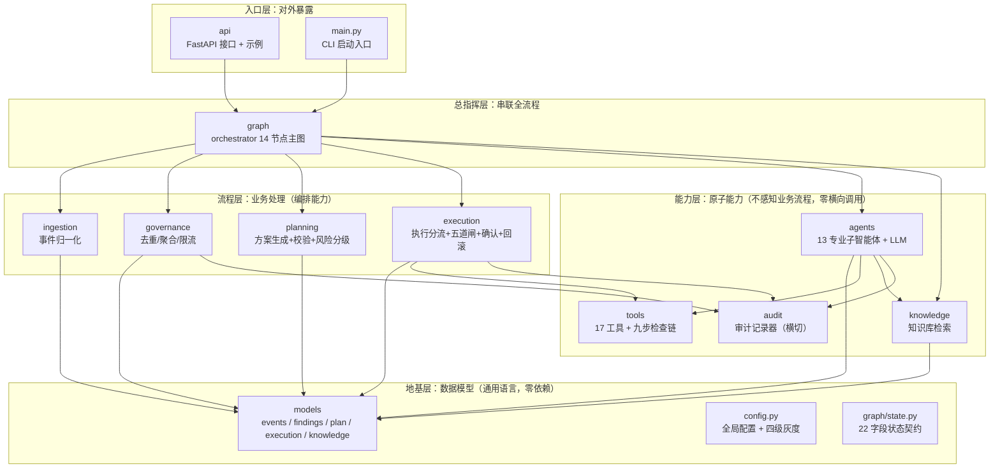

# 代码阅读顺序指南

> 本文档面向第一次接触 `industrial_agent` 源码的读者，给出一套**有逻辑、低认知负担**的阅读顺序。读完后应能完整复述一次事件从接入到结案的端到端调用链。
>
> 配套地图：`src/industrial_agent/README.md`（顶层导览，含分层图、14 节点主图、依赖矩阵），阅读全程当地图翻阅。每个子文件夹下也有各自的 `README.md`，先读它建立全局观，再读代码看细节。

---

## 一、核心原则：自底向上读

本项目的依赖方向是**严格自底向上、无循环依赖**（顶层 README §3 的 import 依赖矩阵可证）：

- 越底层越稳定、越不依赖其他业务模块；
- 越上层越靠近业务流程，依赖下层。

因此**从最底层（零内部依赖）开始读**，当你在上层代码里看到 `import xxx` 时，那个 `xxx` 已经读过、认识了，不会出现"看不懂的外部符号"。

> 反过来，如果从 `main.py` 或 `graph/orchestrator.py` 开始读，会立刻遇到大量不认识的导入符号，读不下去。

---

## 二、推荐阅读顺序（6 个阶段）

```
读代码顺序（自底向上）：
config.py ─► models/* ─► graph/state.py          ← 阶段1 地基：通用语言
        └─► audit/ ─► tools/ ─► knowledge/ ─► agents/   ← 阶段2 积木：原子能力
                    └─► ingestion ─► governance ─► planning ─► execution  ← 阶段3 工序：业务步骤
                                    └─► graph/orchestrator.py              ← 阶段4 总指挥：串流水线
                                            └─► main.py / api/             ← 阶段5 入口：跑起来
```

### 阶段 0：先建立全局地图（约 30 分钟，不读代码）

先读 `src/industrial_agent/README.md`，**不要逐字抠**，重点看这几节：

- §1.5 文件夹速览 + 分层架构图 → 知道 10 个文件夹各干什么、分几层；
- §4 主图 14 节点流程图 → 知道一次事件从接入到结案经过哪些节点；
- §7 风险三道闸控制流图 → 知道工具层/方案层/执行层三层怎么兜风险。

读完你应该能回答："一个设备超温事件进来，系统大概会走哪几步？"

### 阶段 1：地基层 —— 数据契约（零依赖，最稳定）

这一层被所有人引用，但不引用任何人，是各层对话的"通用语言"，**必须最先读懂**。

| 顺序 | 文件 | 读什么 |
|------|------|--------|
| 1 | `config.py` | `Settings` 配置项 + `ROLLOUT_POLICY` 四级灰度开关矩阵（shadow / low_auto / medium_auto / high_controlled）。理解系统有哪些总开关 |
| 2 | `models/events.py` | `StandardEvent` / `Incident` / 枚举 —— 事件接入与治理的载体 |
| 3 | `models/findings.py` | `AgentFinding` —— 子智能体输出长什么样 |
| 4 | `models/knowledge.py` | `KnowledgeChunk` / `KnowledgeHit`（注意 `valid_for_auto_action` 安全属性） |
| 5 | `models/plan.py` | `ProposedAction` / `ResolutionPlan` / `RiskLevel` |
| 6 | `models/execution.py` | `ConfirmRequest` / `ActionExecution` / `AuditRecord` |
| 7 | `graph/state.py` | 22 字段的状态契约 —— 主图节点之间靠它传话、互不覆盖 |

读完你应该能回答："节点之间传数据用什么结构？某个字段在哪个环节产生、哪个环节消费？"

### 阶段 2：能力层 —— 原子积木（不感知主流程）

这四个文件夹彼此**零横向调用**，都是"乐高积木"，由主图按需拼接。按从简单到复杂读：

| 顺序 | 文件夹 | 重点文件与读法 |
|------|--------|----------------|
| 1 | `audit/` | `recorder.py` —— 最简单，横切关注点，先看它（后面很多层都会调它留痕） |
| 2 | `tools/` | ① `contracts.py`（契约）→ ② `adapters.py`（内存数据源）→ ③ **`registry.py`（★九步检查链，核心）** → ④ `factory.py`（17 工具装配） |
| 3 | `knowledge/` | `store.py` —— 检索打分 + 元数据校验（过期/缺元数据 → 不能支撑自动动作） |
| 4 | `agents/` | 最复杂，留到最后：① `industry.py`（零依赖规则）→ ② **`catalog.py`（★13 类智能体唯一事实来源 + 事件→智能体路由）** → ③ `llm.py`（可选增强）→ ④ `base.py`（模板方法）→ ⑤ `specialists.py`（13 类实现）→ ⑥ `factory.py`（编号→实例） |

读完你应该能回答："系统能动哪些工具/查什么数据？13 个智能体分别负责什么？LLM 在哪里、失败了怎么降级？"

### 阶段 3：流程层 —— 把积木组装成业务步骤

这四个对应主图里的"干活节点"，**按主图节点顺序读**，这样能和阶段 0 的流程图对上号：

| 顺序 | 主图节点 | 文件 | 读什么 |
|------|----------|------|--------|
| 1 | 节点 1 | `ingestion/normalizer.py` | 异构报文 → `StandardEvent`，失败怎么走死信 |
| 2 | 节点 2 | `governance/governor.py` | 去重 / 聚合 / 限流 / 优先级，构建 `Incident` |
| 3 | 节点 8/9 | `planning/builder.py` | `PlanBuilder` 生成方案 + `RiskClassifier` 分级 + `PlanValidator` 校验（**方案层闸**） |
| 4 | 节点 10 | `execution/executor.py` | 三分桶执行 + 五道闸 + `ConfirmStore` 人工确认 + 回滚（**执行层闸**） |

读完你应该能回答："三道闸各自在哪、查什么、发现问题怎么处理（就地修正还是拦截）？"

### 阶段 4：总指挥层 —— 把工序串成流水线

| 顺序 | 文件 | 读什么 |
|------|------|--------|
| 1 | **`graph/orchestrator.py`** | ★ 全系统枢纽，14 节点主图 + 唯一装配点。**必须读完前面所有层再读它**，才能看懂每个节点在调谁、state 怎么流转、`_route_by_risk` 三分桶、`interrupt()` 人工确认怎么挂起/恢复 |
| 2 | `graph/执行流程图.md` | 可视化参考，和代码对照 |

读完你应该能**完整复述**一次事件的端到端调用链（对应顶层 README §8 时序图）。

### 阶段 5：入口层 —— 怎么跑起来

| 顺序 | 文件 | 读什么 |
|------|------|--------|
| 1 | `main.py` | CLI 调试入口：`run` / `resume` / `--audit`，看懂 `__interrupt__` 怎么提示恢复 |
| 2 | `api/app.py` + `api/samples.py` | FastAPI 生产入口 + 8 个一键测试示例 |

读完你应该能：本地跑通一次完整流程，看到 `final_answer`，并用 `--audit` 回放审计。

### 阶段 6（可选）：动手验证加深理解

1. 跑 `python -m industrial_agent.main`（内置设备超温示例），对照主图 14 节点理解每步输出；
2. 加 `--audit` 看审计回放，对应三道闸的落痕；
3. 改 `config.py` 的灰度模式（`shadow` → `low_auto` → `medium_auto` → `high_controlled`），观察哪些动作从"转待办"变成"自动执行"、高风险何时进入 `interrupt` 挂起。

---

## 三、捷径：如果你想"先跑起来再说"

按 `阶段 0 → 阶段 5（main.py）→ 实际跑一次 → 再回头按 阶段 1→4 深入` 的顺序。

先看到效果有体感，再带着"这步输出是哪来的"的疑问去读底层代码，效率更高。适合想快速验证、已有同类系统经验的读者。

---

## 四、关键枢纽文件速查表

以下文件是各层的"单点事实来源"或核心控制点，值得反复读、读懂：

| 文件 | 地位 | 为什么关键 |
|------|------|-----------|
| `graph/orchestrator.py` | 唯一装配点 / 总指挥 | 唯一连接所有子系统的文件；改业务流程只动这一处，子系统可独立测试 |
| `agents/catalog.py` | 智能体目录唯一事实来源 | 13 类智能体定义 + 事件类型→智能体路由链 + 第一版范围收敛，全系统路由纯数据驱动 |
| `tools/registry.py` | 工具层闸（九步链） | 所有外部系统访问的唯一入口，权限/风险/审计/幂等/超时集中管控，无法绕过 |
| `planning/builder.py` | 方案层闸 | 方案生成 + 风险分级 + 7 项校验就地修正，交给执行层前的最后一道独立校验 |
| `execution/executor.py` | 执行层闸（五道闸） | 三分桶分流 + 人工确认闭环 + 回滚，真正"动手"前的最后把关 |
| `config.py` | 全局总开关 | 四级灰度策略、LLM 配置、工具开关，所有层从这里读配置 |
| `models/*` | 通用语言 | 被所有层引用，零内部依赖，是跨模块传数据的唯一结构 |

---

## 五、分层架构一图速览



读法提示：数据自下而上流动（L0 是地基），调用自顶向下发起（L4 是入口）。平级模块之间没有箭头，协作全靠 L3 总指挥传话——这是保证流程确定、可回放的关键设计。

---

## 六、读完后的自检清单

能回答以下问题，说明代码已读懂：

1. 一次事件从 `main.py` 进入后，依次经过主图哪 14 个节点？每个节点写入 state 的哪些字段？
2. 三道闸分别在哪个文件？各自检查什么？发现问题是"就地修正"还是"拦截拒绝"？
3. 高风险动作（如设备停机）从产生到执行，要经过哪几层校验、哪几个人工确认环节？`interrupt()` 在哪里挂起、`resume` 如何恢复？
4. 13 个智能体中第一版启用了哪几个？事件类型如何路由到对应的智能体链？（去 `agents/catalog.py` 找答案）
5. 把灰度模式从 `shadow` 切到 `high_controlled`，系统行为会发生哪些变化？（哪些动作从"不执行"变成"自动执行"或"进入确认"）
6. 如果要新增一种事件类型的处置，需要改哪几个文件？（提示：catalog 路由 + planning 动作模板，通常不用改 orchestrator 核心结构）