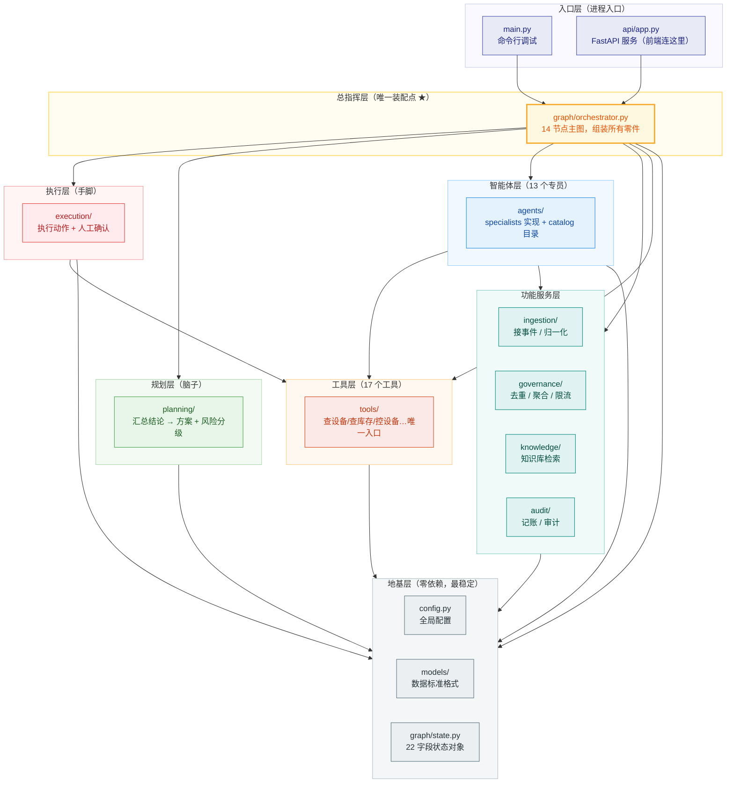

# 工业多智能体系统 · 大白话解读

> 本文是 `src/industrial_agent/README.md`（源码导览）的通俗版讲解，用大白话解释这套系统在干什么、怎么组织、关键设计为什么这么做。适合刚接触项目的人快速建立整体认知；想逐行核对事实请回到原始 README。

---

## 一句话总结

这套系统做的事是：**工厂里冒出一个异常事件（比如设备报警、缺料、质量不良），系统自动判断它属于哪类问题 → 派几个专职"AI 专员"分头去查 → 汇总结论 → 出处置方案 → 评估风险 → 能自动做的自动做、需要人拍板的挂起等人确认 → 全程留痕可回放。**

---

## 1. 模块定位

`industrial_agent` 就是整个系统的**主代码包**，管的是一条完整闭环：

```
事件进来 → 治理 → 多个 AI 专员协同取证 → 出方案 → 评风险 → 执行/等人确认 → 记账
```

几个核心设计思想：

- **编排底座是 LangGraph**：整个流程画成一张有 14 个节点的"流程图"，按顺序跑，流程确定、能回放。
- **Supervisor 模式**：有个"总指挥"（orchestrator）调度一群"专业专员"（子 Agent），专员之间**不互相打电话**，全靠总指挥传话——这样流程不会乱，好测试。
- **风险三道闸**：工具层、方案层、执行层各设一道卡，任何一道说"不行"就不执行。
- **规则优先，大模型可选**：先用硬规则出结论，大模型（百炼/OpenAI）只是"锦上添花"，没配 key 或超时了，系统照样完整跑，不会瘫。
- **第一版只开 5 个专员**：A1/A3/B1/B3/B4（其中 A1、B1 只许查不许改），由 `catalog.py` 里的 `FIRST_RELEASE_CODES` 统一管控——想多开改这一处就行。

---

## 2. 目录结构（像盖楼一样从下到上理解）

| 层级 | 文件/目录 | 大白话 |
|---|---|---|
| 地基 | `config.py`、`models/`、`graph/state.py` | 配置项 + 各种数据的"标准格式"（事件长啥样、结论长啥样），谁都依赖它，它不依赖别人 |
| 工具间 | `tools/` | 所有调外部系统（查设备、查库存、控制设备等）的统一入口，17 个工具 |
| 功能间 | `ingestion/`、`governance/`、`knowledge/`、`audit/` | 接事件、管事件（去重/限流）、查知识库、记账 |
| 智能体 | `agents/` | 13 个专员的实现 + 目录（谁是谁、会用啥工具） |
| 脑子 | `planning/` | 把各专员的结论汇总成方案 + 评估风险 |
| 手脚 | `execution/` | 执行方案动作 + 等人确认 |
| 总指挥 | `graph/orchestrator.py` | ★ 唯一把上面所有零件组装起来、画出 14 节点流程图的文件 |
| 入口 | `main.py`、`api/app.py` | 命令行调试入口 / Web 服务入口（前端连的就是这个） |

对应的层级图（越靠上越靠近业务流程，越靠下越稳定；箭头 = 依赖 / import 下层）：



> 读法：`orchestrator.py` 是唯一横跨所有下层的枢纽；平级模块（如 governance 和 knowledge）之间没有直接箭头，互不调用，协作全靠总指挥传话。

---

## 3. 分层架构：为什么这么分层

核心就三句话：

1. **越往下越稳定**：`models/`、`config.py` 这些地基文件，不 import 任何内部东西，改它们要谨慎。
2. **平级模块互不调用**：比如治理模块不直接调知识库，知识库也不调治理——它们之间要协作，只能通过总指挥 orchestrator 传话。
3. **`orchestrator.py` 是唯一的"枢纽"**：全系统只有它一个文件 import 了所有子系统。**改流程只动这一处**，其他模块能独立测试。

> 这就是为什么加"单 Agent 模拟"功能时，只需要在 orchestrator 里加一个 `run_single_agent` 方法、在 app.py 加个接口——因为所有零件的装配都在 orchestrator 这一处。

---

## 4. 主图：14 节点流程图（系统的心脏）

一个事件进来后，依次走过这 14 站：

```
1. 归一化事件        → 把五花八门的报文（WMS/MES/QMS/EAM...）转成统一格式
2. 治理             → 去重、聚合、限流、排优先级（重复/被限流的直接结束）
3. 判定事件类型      → 这是设备异常？质量？物料？还是查询？
4. 路由子任务        → 根据类型，决定派哪几个专员去查（查 catalog 表）
5. 知识检索 ★        → 先去知识库捞相关资料（在专员取证之前，让他们带着背景去查）
6. 并行运行子 Agent  → 多个专员同时干活（线程池并行）
7. 合并发现          → 把各专员的结论拼到一起，找冲突、找数据缺口
8. 生成处置方案      → 汇总成一张 ResolutionPlan（含动作清单）
9. 方案校验          → 检查方案靠不靠谱，修正置信度/可执行性
   └─ 风险路由分三路：
10a. 低风险自动执行   → 直接做
10b. 中风险灰度执行   → 看灰度策略放不放
10c. 高风险人工确认   → interrupt() 挂起，等人批准
11. 记录审计结果      → 写审计日志
12. 生成最终结论      → 给用户一句人话总结
```

> 注意第 5 步**知识检索在取证之前**——这是刻意设计：让专员带着"已有知识"去查证据，不是瞎查。

---

## 5. 事件 → 专员的路由关系（来了个事件，该派谁去？）

路由是**纯查表**的，全写在 `catalog.py`，总指挥不硬编码。比如：

- 设备异常 → 走 `equipment` 子图 → 派 **B3（主脑）→ A1（工位装配）→ A3（质量追溯）**，再注入 **C1（轨道装备规则）**
- 质量异常 → 走 `quality` 子图 → 派 **A3 → B4 → B3**，注入 C1/C2 规则
- 缺料/生产异常 → 走 `production` 子图 → 派 **A2 → B2 → A4 → A1**，注入 C3

### 第一版范围收敛

默认 `release_scope="first"`，会把路由链过滤到只剩 `{A1, A3, B1, B3, B4}`，还保证"主脑 B3"不丢（如果过滤后主脑没了，就回落成只跑 B3 只读诊断）。

A1、B1 在第一版是**只读**的——它们的 `allow_write=False`，想调写/控制类工具会在工具层第四道闸被拦住。

---

## 6. 工具层：所有专员调外部系统的唯一入口

所有专员**调外部系统的唯一入口**是 `ToolRegistry.invoke`。工具分两个维度：

- **kind（类型）**：read（查）/ write（写）/ control（控制）
- **risk（风险）**：low / medium / high

调用时走**九步检查链**，核心是这几步：

1. 工具存在吗？
2. 你有这个角色权限吗？
3. 高风险工具但没开 `allow_high_risk`？拦！
4. 写/控制工具但没开 `allow_write`？拦！（A1/B1 只读、shadow 模式都是靠这拦）
5. 幂等：同一个请求查过了直接返回缓存
6. 执行前记账 → 执行（带超时、读失败重试 2 次）→ 执行后记账

> 被拦了**不抛异常**，而是返回一个 `degraded=True` 的结果——保证专员的取证流程不中断，只是"这个数据没拿到"，它会继续往下查别的。

总共装配了 **17 个工具**：9 个只读（查设备状态/报警/工单/库存/批次/质量等）、5 个写（加载作业指导书/绑定码/建工票等）、3 个控制（调路线/控设备/冻结批次）。真实项目里只需把 `adapters.py` 里的示例数据换成对接 MES/WMS 的真实接口，别的都不用动。

---

## 7. 风险三道闸：同一个动作被独立查三遍

同一个高风险动作会被**独立的三层**各查一遍，任何一层说不行就不执行，每层都记账：

| 闸 | 在哪 | 查什么 |
|---|---|---|
| 闸①工具层 | `ToolRegistry` | 有没有写权限、有没有高风险权限 |
| 闸②方案层 | `PlanValidator` | 置信度够不够、高风险有没有标注要确认、知识是不是过期了 → 不行就把动作标成不可执行或降置信度 |
| 闸③执行层 | `ActionExecutor` + 灰度策略 | 按风险分三桶：low 自动做 / medium 看灰度 / high 走人工确认 |

### 四级灰度策略

用三个开关（`allow_write`、`allow_medium_auto`、`allow_high_confirm`）控制能做到哪一步：

| 模式 | 效果 |
|---|---|
| `shadow`（默认） | 只取证+出方案，**啥也不执行**，所有写/控全被闸①拦 |
| `low_auto` | 开放低风险自动执行，中风险转人工待办 |
| `medium_auto` | 低+中风险自动执行，高风险还是不确认 |
| `high_controlled` | 全开，高风险走完人工确认才执行 |

> 系统默认跑的就是 `shadow` 模式（前端顶部有徽标显示），所以所有动作都只是"建议"，不会真的去控制设备——安全。

---

## 8. 端到端数据流：一个事件的完整旅行

```
CLI/API → 总指挥 → 归一化 → 治理 → 查路由表 → 检索知识
   → [并行] 各专员查工具/问大模型 → 回传结论
   → 合并 → 出方案 → 校验 → 三分桶
   → [自动执行 或 等人确认 resume]
   → 记账 → 返回最终结论
```

几个亮点：

- 每一步都写审计；
- 大模型失败自动降级走规则兜底；
- 高风险 `interrupt()` 挂起后，**必须外部显式 `resume` 才能继续**，不会自己默认同意。

---

## 9. import 依赖矩阵：架构干不干净

一张大表格，行是"谁 import 别人"，列是"被谁 import"，✓ 表示有直接依赖。结论：

- **全空行** = 零依赖地基（config、5 个 models、state、contracts、adapters、industry）
- **全勾行** = `orchestrator`，只有它依赖所有人，坐实中枢地位
- **全表无循环依赖**——代码架构很干净

---

## 10. 各文件速查（改文件前先翻这里）

- `config.py`：配置读 `.env`（前缀 `IAMS_`），`get_settings()` 是单例；`ensure_dirs()` 会建 `var/audit` 和 `var/knowledge` 目录。
- `normalizer.py`：异构报文 → 标准事件，失败了走"死信"直接结束，不往下传脏数据。
- `governor.py`：四步治理——去重、聚合、限流、优先级打分。
- `store.py`：知识库，目录空了会回退到内置种子知识；命中知识会打分（命中维度加分、时效加分），必需元数据缺失时会标 `valid_for_auto_action=False`，禁止自动动作。
- `specialists.py`：13 个专员的真正实现，还有 6 个早期遗留类（没接主图，仅供参考）。
- `executor.py`：`ConfirmStore` 的确认请求有 TTL（默认 3600 秒），**超时置 expired 且严禁默认同意**——这是安全底线。

---

## 11. 数据载体流转（数据一站站怎么变形）

```
raw_event → StandardEvent → Incident → incident_type
  → agent_codes → KnowledgeHit[] → AgentFinding{}
  → merged_findings → ResolutionPlan → risk_level
  → executed_actions / confirm_request → final_answer
```

所有这些中间产物都存在 `IndustrialAgentState`（22 个字段）里，节点之间靠这个状态对象传话。

---

## 12. 七条设计哲学（二次开发要守住的底线）

1. **单一事实来源**：13 个专员的规格/路由/范围/只读/知识库全在 `catalog.py`，改路由只动这一个文件。
2. **唯一装配点**：`orchestrator.py` 是唯一组装所有零件的地方，子系统零横向调用。
3. **契约先行**：先定好数据结构（models/contracts/state），上层怎么改都不影响下层。
4. **三道闸独立可审计**：每层拦截都记账，互不替代。
5. **规则优先 + LLM 可选降级**：大模型只是增强，没有也能跑。
6. **人工确认安全默认**：超时即过期、绝不默认同意，必须显式 resume。
7. **可回放**：全链路写审计到 `var/audit/audit-YYYYMMDD.jsonl`，按 trace_id 能还原任意一次处置的完整决策链。

---

## 附：和前端三个视图的对应关系

- **系统总览页**：展示第 4 节的 14 节点图 + 第 5 节的 13 个专员目录。
- **单 Agent 模拟页**：`run_single_agent` 方法在 orchestrator 里"绕过"完整 14 节点，只跑前几步（归一化 → 治理 → 知识检索 → 单个专员），能逐个观察每个专员的取证结论——对应第 6 节工具调用 + 第 8 节取证部分。
- **端到端编排页**：完整跑第 4 节的 14 节点，展示节点轨迹（`node_trace`）、各专员结论、方案动作、三分桶执行、以及高风险时的人工确认 `resume`，对应第 7、8 节。