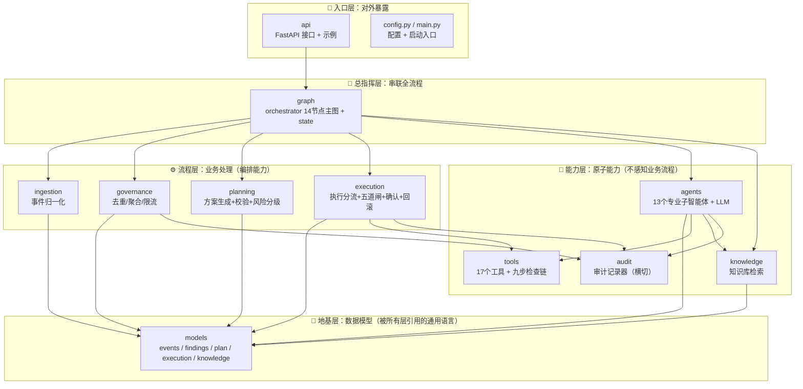
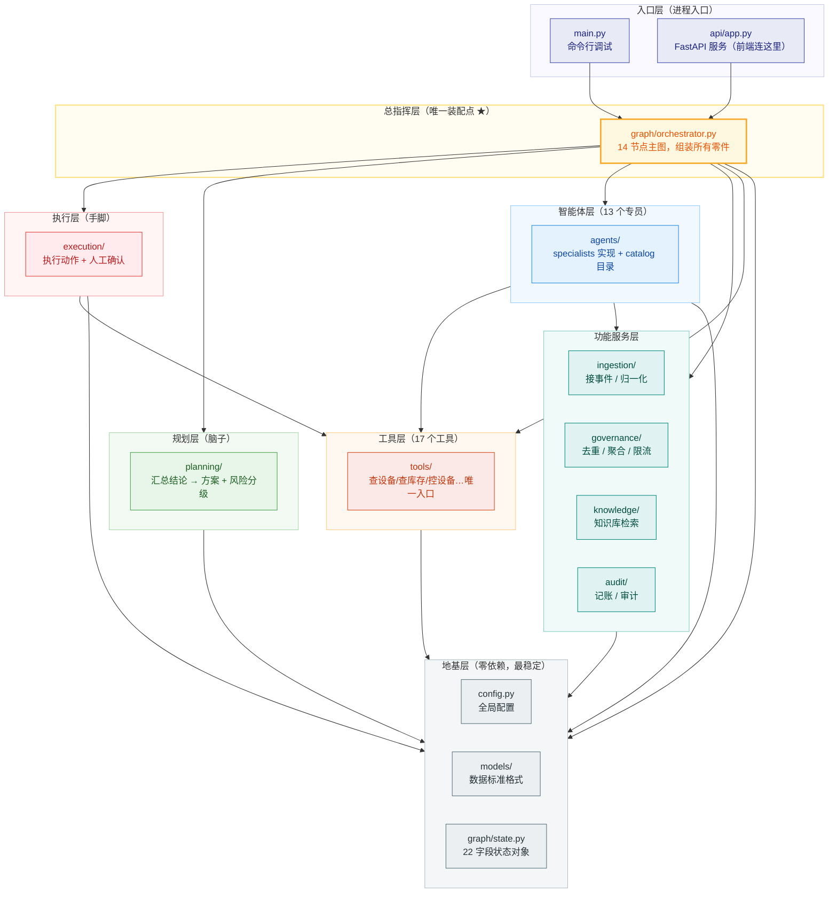
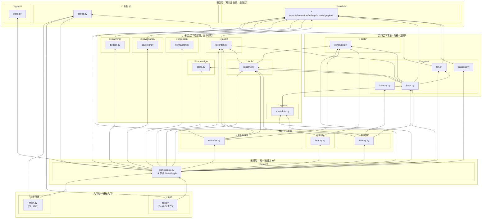
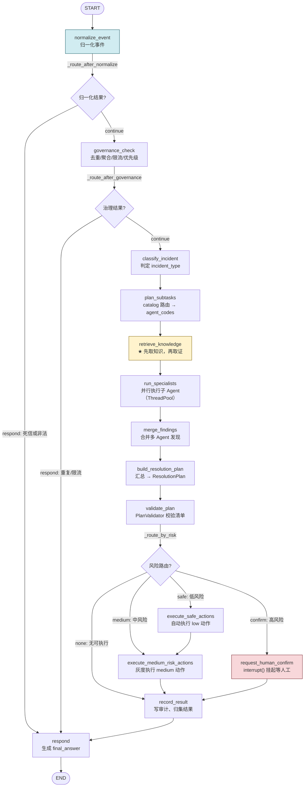
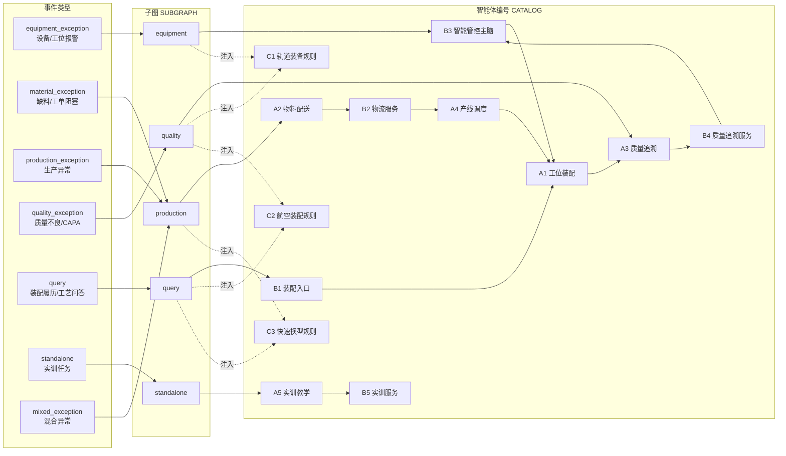
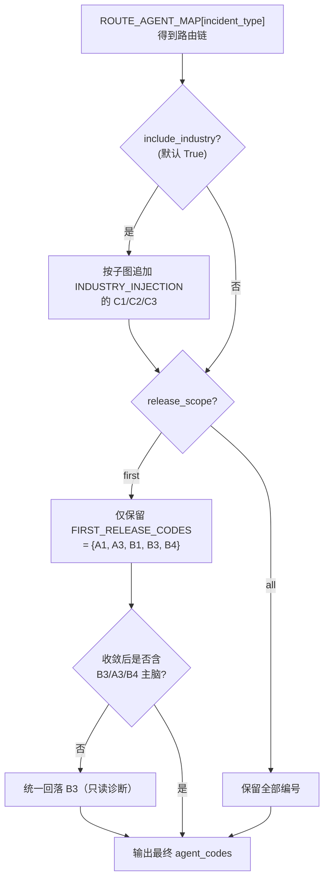
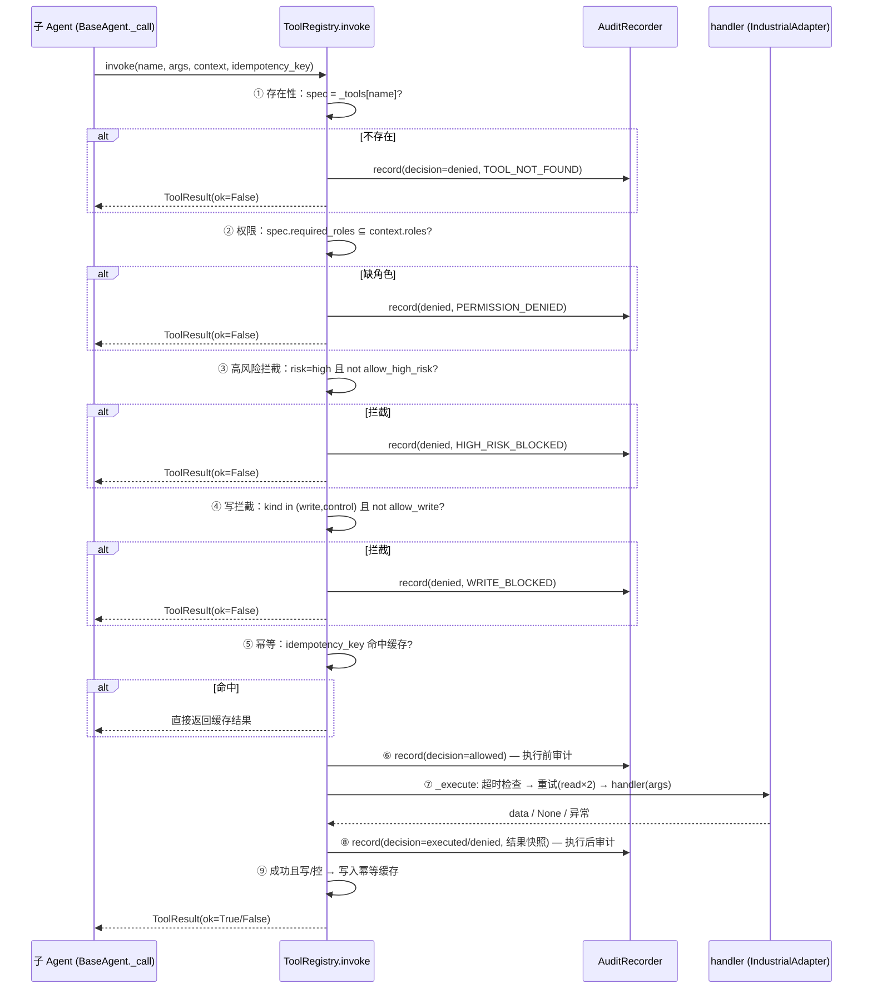
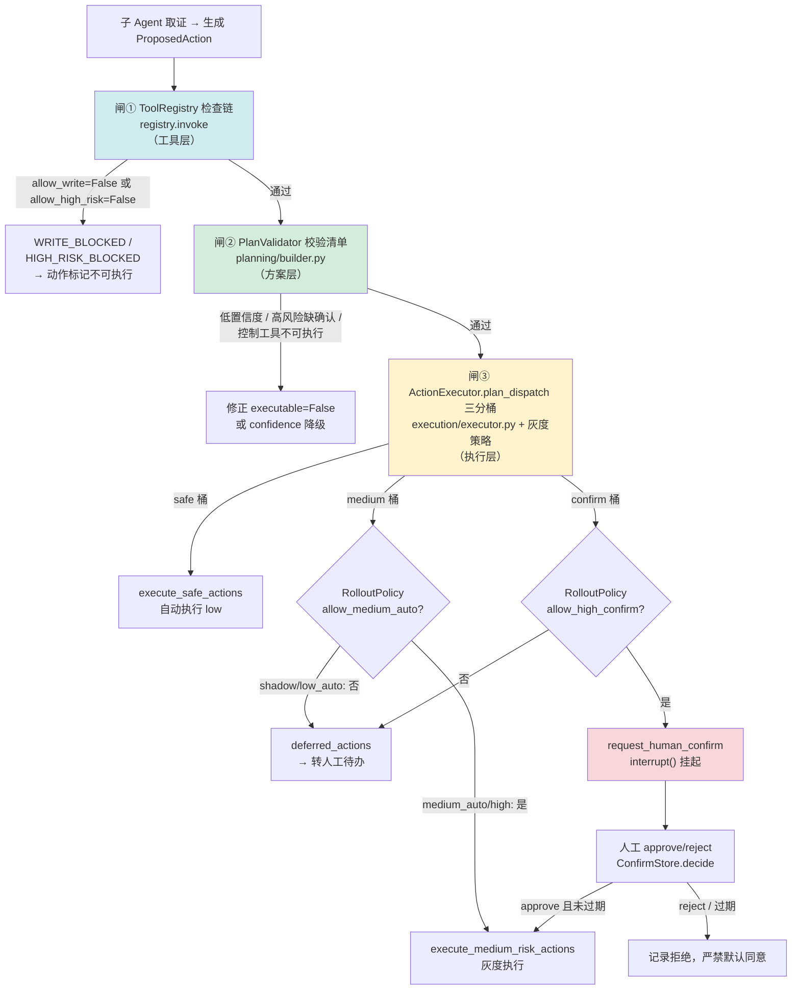
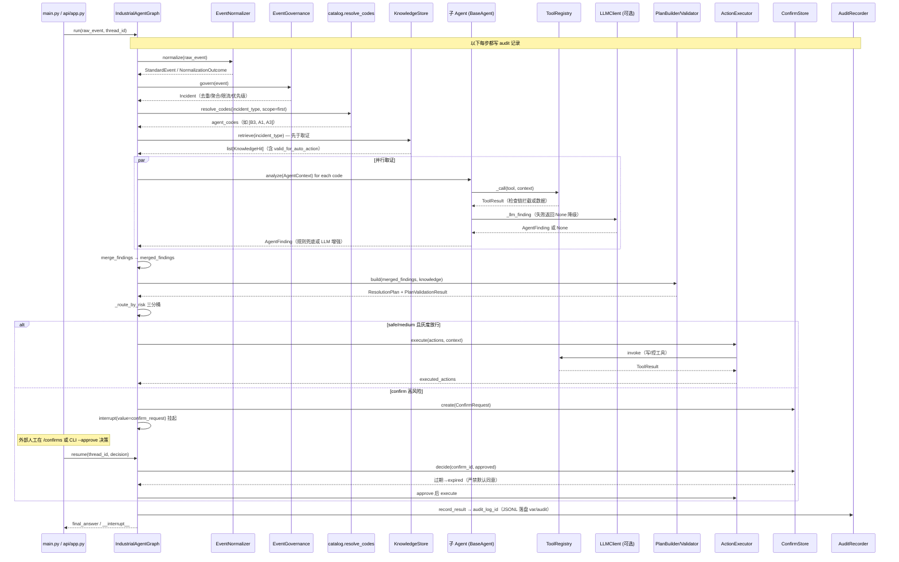

# industrial_agent 模块说明（详细版）

> 本文件是 `src/industrial_agent` 源码目录的**完整导览**：逐文件职责、关键对外接口、以及文件之间的内部关联图（含分层依赖图、主图流程图、事件路由图、工具检查链时序图、风险三道闸控制流图、端到端数据流时序图、import 依赖矩阵）。
> 所有图与事实均与当前代码逐行核对，可作为阅读与二次开发的地图。
> 更高层的设计意图见 `docs/工业多智能体系统完整方案.md`；端到端运行链路见 `docs/代码结构与关联分析.md`。

---

## 1. 模块定位

`industrial_agent` 是工业多智能体系统的主包，承载从**事件接入 → 治理 → 多智能体协同取证 → 方案生成 → 风险分级 → 执行/人工确认 → 审计**的完整闭环。核心设计：

- **编排底座**：LangChain + LangGraph，主图为 `graph/orchestrator.py` 中的 14 节点 `StateGraph`；
- **架构模式**：Supervisor 主调度（orchestrator）+ 专业子 Agent 协同；子系统之间**零横向调用**，全部由主图节点串联，保证流程确定、可回放；
- **风险控制**：工具层 / 方案层 / 执行层三道独立闸门 + 四级灰度策略；
- **降级策略**：规则优先，LLM（百炼/OpenAI 兼容）可选增强，失败自动降级，无 LLM 仍完整运行；
- **第一版范围**：仅启用 A1/A3/B1/B3/B4（其中 A1/B1 只读取证），由 `agents/catalog.py` 的 `FIRST_RELEASE_CODES` 单一事实来源收敛。

---

## 1.5 文件夹关联与作用速览

如果把整个系统比作一条**自动化处置流水线**，10 个文件夹就是流水线上的 10 个工位，3 个根文件是地基和总开关。下面用一张分层图 + 一张数据流图，快速看清它们各自干什么、怎么协作。

### 分层架构图（数据自下而上、调用自顶向下）



### 每层每个文件夹的作用

**🔧 地基层（1 个）—— `models`**
纯数据模型，全是 Pydantic 类（`events` / `findings` / `plan` / `execution` / `knowledge`）。**被所有其他文件夹引用**，是各层之间对话的"通用语言"。它不包含任何业务逻辑，只定义"数据长什么样"，所以能放在最底层被所有人依赖而不产生循环依赖。

**🔧 能力层（4 个）—— 原子能力，不感知主流程**

| 文件夹 | 作用 |
|--------|------|
| `tools` | 工具层：17 个默认工具（9 读 + 5 写 + 3 控制），`registry.py` 里有**九步检查链**。这是系统真正"动手"的地方 |
| `knowledge` | 知识检索：按事件类型 + 元数据维度查知识库，返回命中片段（含是否过期标记） |
| `agents` | 13 个专业子智能体（设备/物料/质量/工艺等），每个封装取证逻辑，可走 LLM 或规则 |
| `audit` | 审计记录器（横切关注点）：任何层想留痕都调它，落内存 + JSONL 落盘。**不主动做事，只被动记录** |

这四个是"乐高积木"：`graph` 按需拼，彼此之间不直接调用（子系统零横向调用）。

**⚙️ 流程层（4 个）—— 把能力组装成业务步骤**

| 文件夹 | 作用 | 在主图中的位置 |
|--------|------|----------------|
| `ingestion` | 事件归一化：把 WMS/MES/EAM 等异构报文转成统一 `StandardEvent` | 主图节点 1 |
| `governance` | 事件治理：窗口去重、按实体聚合、并发/限流，构建 `Incident` | 主图节点 2 |
| `planning` | 方案生成（`PlanBuilder`）+ 风险分级（`RiskClassifier`）+ 方案校验（`PlanValidator`），**方案层的独立闸** | 主图节点 8 / 9 |
| `execution` | 执行分流（三分桶）+ 五道闸校验 + 人工确认闭环（`ConfirmStore`）+ 回滚，**执行层的独立闸** | 主图节点 10 |

这四个对应主图里的"干活节点"，每个都只负责流程中的一步。

**👑 总指挥层（1 个）—— `graph`**
系统唯一装配点 + 总指挥。`orchestrator.py` 构建 14 节点 LangGraph 主图，把上面所有能力**按确定顺序串联**；`state.py` 定义 22 字段的状态契约，节点之间靠 state 传话、互不覆盖。**它不实现具体业务，只负责"调度"**——子系统之间想交互，必须经过主图节点，保证流程确定、可回放。

**🚪 入口层（1 个 + 2 文件）**

| 项 | 作用 |
|----|------|
| `api` | FastAPI 接口层：`app.py` 暴露 `/api/run`、`/api/agents`、`/api/graph` 等接口，生产期还托管前端 `frontend/dist`；`samples.py` 提供 8 个一键测试示例 |
| `config.py` | 全局配置（灰度策略、LLM 配置、工具开关等），所有层从这里读配置 |
| `main.py` | 启动入口：装配各子系统 → 实例化 `IndustrialAgentGraph` → 启动 FastAPI |

### 一次事件的数据怎么在各文件夹间流动

```
外部原始报文（WMS格式）
   │
   ▼
api/app.py ──接收──► graph/orchestrator.py（run 入口）
   │
   ▼ 节点1
ingestion ──归一化──► StandardEvent（写入 models.events）
   │
   ▼ 节点2
governance ──去重/聚合/限流──► Incident，失败则提前结束
   │
   ▼ 节点5
knowledge ──检索──► KnowledgeHit（写入 models.knowledge）
   │
   ▼ 节点6
agents ──并发取证──► 每个调 tools 取数 + 复用 knowledge ──► AgentFinding
   │                    │                          │
   │                    ▼                          ▼
   │              tools（九步闸）              audit（落痕）
   ▼ 节点8-9
planning ──汇总 findings + knowledge──► ResolutionPlan + 风险分级 + 校验
   │
   ▼ 节点10
execution ──三分桶执行──► 低风险自动跑 tools / 高风险走 ConfirmStore 人工确认
   │                    │
   │                    ▼
   │              tools（真正执行）+ audit（全程记录）
   ▼ 节点11-12
graph ──record_result + respond──► final_answer
   │
   ▼
api ──返回 JSON──► 前端
```

### 几个关键的关联设计

1. **`models` 是唯一的"公共依赖"**：所有层都 import 它，但它不 import 任何业务层——这是避免循环依赖的根基。
2. **子系统零横向调用**：`agents` 不会直接调 `planning`，`execution` 不会直接调 `governance`。它们想交换信息，只能通过 `graph` 的 state 传话。这保证了流程确定、可回放。
3. **三道闸分布在三个文件夹**：工具层（`tools/registry.py` 九步链）、方案层（`planning/builder.py` 的 `PlanValidator`）、执行层（`execution/executor.py` 的五道闸）——三层独立校验，一层漏了下一层还能兜住。
4. **`audit` 是横切的**：它不属于任何主流程节点，但 `agents`、`execution`、`governance` 都会调它留痕，保证事后能追溯整条链路。
5. **`graph` 只调度不干活**：它是"指挥"，真正的能力都在能力层和流程层。想加新功能，通常是在 `agents` 加智能体或 `tools` 加工具，主图连线微调即可，不用改 `graph` 的核心结构。

> 一句话总结：**`models` 定语言，`tools`/`knowledge`/`agents`/`audit` 是积木，`ingestion`/`governance`/`planning`/`execution` 是工序，`graph` 是把工序串起来的流水线，`api` 是对外接单的窗口。** 更细的逐文件说明见 §10，完整依赖关系见 §3。

---

## 2. 目录结构树

```
src/industrial_agent/
├── __init__.py                  # 包入口：re-export Settings / get_settings
├── config.py                    # 全局配置 + 四级灰度策略（最底层，零内部依赖）
├── main.py                      # CLI 调试入口（run / resume / --audit）
├── api/
│   ├── __init__.py
│   └── app.py                   # FastAPI 生产入口（/events /confirms /audit）
├── models/                      # 数据契约层（pydantic，零内部依赖）
│   ├── __init__.py
│   ├── events.py                # StandardEvent / Incident / 事件枚举
│   ├── execution.py             # ConfirmRequest / ActionExecution / AuditRecord
│   ├── findings.py              # AgentFinding（子 Agent 输出）
│   ├── knowledge.py             # KnowledgeChunk / KnowledgeHit / KnowledgeBase
│   └── plan.py                  # ProposedAction / ResolutionPlan / RiskLevel
├── ingestion/
│   ├── __init__.py
│   └── normalizer.py            # EventNormalizer：异构报文 → StandardEvent
├── governance/
│   ├── __init__.py
│   └── governor.py              # EventGovernance：去重/聚合/限流/优先级
├── knowledge/
│   ├── __init__.py
│   └── store.py                 # KnowledgeStore：加载/检索/元数据校验
├── tools/                       # 统一工具层
│   ├── __init__.py
│   ├── contracts.py             # 工具契约：ToolSpec / ToolContext / ToolResult
│   ├── adapters.py              # IndustrialAdapter：示例内存数据源（种子数据）
│   ├── registry.py              # ToolRegistry：唯一入口 + 九步前置检查链
│   └── factory.py               # build_default_registry：装配 17 个默认工具
├── audit/
│   ├── __init__.py
│   └── recorder.py              # AuditRecorder：内存 + 按天 JSONL 落盘
├── agents/                      # 智能体层
│   ├── __init__.py
│   ├── base.py                  # AgentContext + BaseAgent 模板方法
│   ├── llm.py                   # LLMClient：可选大模型增强
│   ├── industry.py              # C1–C3 行业规则包
│   ├── catalog.py               # ★ 13 类智能体唯一事实来源
│   ├── specialists.py           # 13 类子 Agent 具体实现
│   └── factory.py               # build_agent：编号 → 实例
├── planning/
│   ├── __init__.py
│   └── builder.py               # RiskClassifier / PlanBuilder / PlanValidator
├── execution/
│   ├── __init__.py
│   └── executor.py              # ConfirmStore + ActionExecutor（三分桶）
└── graph/
    ├── __init__.py
    ├── state.py                 # IndustrialAgentState（22 字段状态契约）
    └── orchestrator.py          # ★ 14 节点主图，唯一装配点
```

对应的层级图（越靠上越靠近业务流程，越靠下越稳定；箭头 = 依赖 / import 下层）：



> 读法：`graph/orchestrator.py` 是唯一横跨全部下层的枢纽；平级模块（如 governance 和 knowledge）之间没有直接箭头，互不调用，协作全靠总指挥传话。模块间的详细 import 依赖见 §3。

---

## 3. 分层架构与依赖方向

依赖方向**严格自底向上，无循环**：越底层越稳定，越上层越靠近业务流程。`graph/orchestrator.py` 是唯一横跨全部下层的装配点。



> 读法：箭头 = "依赖 / import"。底层节点没有任何指出去的箭头，是系统最稳定的契约。每个 📁 子框 = 一个文件夹，框内是该文件夹下的文件；同一个文件夹（如 `agents/`、`tools/`、`graph/`）可能在不同层出现，因为它的文件分属不同职责层。

**本图涉及的文件夹清单**（共 10 个文件夹 + 根目录文件）：

| 文件夹 | 图中出现的文件 | 所属层 |
|--------|----------------|--------|
| `api/` | `app.py` | 入口层 |
| `graph/` | `orchestrator.py`、`state.py` | 编排层 / 模型层 |
| `execution/` | `executor.py` | 执行装配层 |
| `agents/` | `factory.py`、`specialists.py`、`catalog.py`、`industry.py`、`llm.py`、`base.py` | 执行装配层 / 服务层 / 契约层 |
| `tools/` | `factory.py`、`registry.py`、`contracts.py` | 执行装配层 / 服务层 / 契约层 |
| `planning/` | `builder.py` | 服务层 |
| `governance/` | `governor.py` | 服务层 |
| `ingestion/` | `normalizer.py` | 服务层 |
| `knowledge/` | `store.py` | 服务层 |
| `audit/` | `recorder.py` | 服务层 |
| `models/` | `events.py`、`execution.py`、`findings.py`、`knowledge.py`、`plan.py` | 模型层 |
| 根目录 | `main.py`、`config.py` | 入口层 / 模型层 |

**三个关键结论**：
1. `models/*`、`config.py`、`graph/state.py`、`tools/contracts.py`、`agents/industry.py` 是**零内部依赖**的地基；
2. 服务层各模块（governor / normalizer / store / builder / registry / specialists）**互不 import**，只依赖模型层与契约层，横向调用全靠 orchestrator 串联；
3. `orchestrator.py` 是唯一连接所有子系统的文件——改流程只动这一处，子系统可独立测试。

---

## 4. 主图：14 节点 LangGraph 流程图

主图在 `graph/orchestrator.py:112-161` 构建，用 `InMemorySaver` 编译（支持 interrupt 人工确认）。**知识检索在子 Agent 取证之前**执行，保证取证时已有上下文。



**节点与状态字段的对应**（状态定义见 `graph/state.py`，共 22 字段）：

| 节点 | 写入/更新的状态字段 |
|---|---|
| normalize_event | `event`、`errors`、`node_trace` |
| governance_check | `incident`、`duplicate`、`throttled` |
| classify_incident | `incident_type` |
| plan_subtasks | `subtasks`、`agent_codes` |
| retrieve_knowledge | `knowledge_refs` |
| run_specialists | `agent_findings` |
| merge_findings | `merged_findings` |
| build_resolution_plan | `resolution_plan` |
| validate_plan | `risk_level`、`need_human_confirm`、`validation_issues`（修正 `executable`/`confidence`） |
| execute_safe_actions / medium | `executed_actions`、`deferred_actions` |
| request_human_confirm | `confirm_request`、`confirm_status`（含 `__interrupt__`） |
| record_result | `audit_log_id` |
| respond | `final_answer` |

> 说明：`safe` 路径会先执行 `execute_safe_actions`，再**串接** `execute_medium_risk_actions`（`orchestrator.py:156`），即低风险动作执行完才轮到中风险；`medium` 路径直接从中风险开始；`confirm` 路径在 `request_human_confirm` 内 `interrupt()` 挂起，由 `resume` 恢复后流向 `record_result`。

---

## 5. 事件 → 子图 → 智能体路由关系图

路由是**纯数据驱动**的，全部定义在 `agents/catalog.py`，orchestrator 不硬编码任何业务路由。

### 5.1 路由链（`ROUTE_AGENT_MAP`）+ 行业注入（`INDUSTRY_INJECTION`）



> 实线 = `ROUTE_AGENT_MAP` 路由链顺序；虚线 = `INDUSTRY_INJECTION` 行业规则注入。C1–C3 不调工具，只发射规则与确认边界（`IndustryRuleAgent`，见 `agents/factory.py:53-56`）。

### 5.2 第一版范围收敛（`resolve_codes` + `FIRST_RELEASE_CODES`）

`config.agent_release_scope` 默认为 `"first"`，`catalog.resolve_codes` 会把路由链过滤到第一版可用范围，并保证主脑不缺失：



第一版各 Agent 的**只读约束**由 `is_readonly` 判定（`catalog.py:394-398`）：A1、B1 的 `first_release_readonly=True`，其 `ToolContext.allow_write=False`，写/控制工具在 `ToolRegistry` 第四道检查被拦截。

---

## 6. 工具层：检查链与装配关系

所有子 Agent 访问外部系统的**唯一入口**是 `ToolRegistry.invoke`。工具按 `kind`（read/write/control）× `risk`（low/medium/high）双维度分级，由 `ToolContext` 的两个开关（`allow_write` / `allow_high_risk`）控制放行——这两个开关同时承载"只读 Agent"和"shadow 灰度模式"两种语义。

### 6.1 `ToolRegistry.invoke` 九步检查链（`tools/registry.py:43-123`）



被拦截时 `_deny`（`registry.py:167-195`）统一返回 `ToolResult(degraded=True)` 并写审计，**不抛异常**，保证 Agent 取证流程不中断。

### 6.2 工具装配与数量（`tools/factory.py`）

`build_default_registry` 装配 **17 个默认工具**：

| kind \ risk | low | medium | high | 合计 |
|---|---|---|---|---|
| **read** | query_device_status、query_recent_alarms、query_device_trend、query_work_order、query_material_stock、query_batch、query_quality_record、reuse_process_template、training_score（9） | — | — | 9 |
| **write** | — | load_esop、bind_codes、create_dispatch_suggestion、create_ticket_draft、send_notification（5） | — | 5 |
| **control** | — | — | adjust_delivery_route、control_device、freeze_batch（3） | 3 |
| **合计** | 9 | 5 | 3 | **17** |

> 装配关系：`tools/factory.py` → `tools/registry.py`（注册 ToolSpec）→ `tools/adapters.py`（提供 handler 实现）→ `tools/contracts.py`（ToolSpec/ToolContext 契约）。真实项目只需替换 `IndustrialAdapter` 的 handler 为系统接口，其余不动。

---

## 7. 风险三道闸：端到端控制流

同一个高风险动作会被三层独立校验，任何一层拦截都不会执行，且每层都写审计（可追溯）。



**四级灰度策略**（`config.py:ROLLOUT_POLICY`）通过控制 `allow_write` / `allow_medium_auto` / `allow_high_confirm` 三个开关决定哪些桶能真正执行：

| 模式 | allow_write | allow_medium_auto | allow_high_confirm | 实际效果 |
|---|---|---|---|---|
| `shadow`（默认） | ❌ | ❌ | ❌ | 只取证+出方案，不执行任何写；所有写/控被闸①拦截 |
| `low_auto` | ✅ | ❌ | ❌ | 开放 low 自动；medium 转待办；high 不进入确认 |
| `medium_auto` | ✅ | ✅ | ❌ | low+medium 自动；high 仍不确认 |
| `high_controlled` | ✅ | ✅ | ✅ | 全开放，high 走人工确认后执行 |

---

## 8. 端到端运行数据流时序图

一次物料异常事件从接入到结案的完整调用链（标注数据载体在节点间的流转）：



---

## 9. import 依赖矩阵

行 = import 方，列 = 被 import 方；✓ 表示存在直接 import（不含 `__init__.py` 的 re-export）。**全表无循环依赖**。

| ↓ 行 / 列 → | cfg | m:ev | m:ex | m:fi | m:kn | m:pl | state | cont | adapt | rec | store | norm | gov | cat | ind | llm | base | spec | afac | reg | tfac | bld | exec | orch |
|---|---|---|---|---|---|---|---|---|---|---|---|---|---|---|---|---|---|---|---|---|---|---|---|---|
| **config** | | | | | | | | | | | | | | | | | | | | | | | | |
| **models/ev** | | | | | | | | | | | | | | | | | | | | | | | | |
| **models/ex** | | | | | | | | | | | | | | | | | | | | | | | | |
| **models/fi** | | | | | | | | | | | | | | | | | | | | | | | | |
| **models/kn** | | | | | | | | | | | | | | | | | | | | | | | | |
| **models/pl** | | | | | | | | | | | | | | | | | | | | | | | | |
| **graph/state** | | | | | | | | | | | | | | | | | | | | | | | | |
| **tools/contracts** | | | | | | | | | | | | | | | | | | | | | | | | |
| **tools/adapters** | | | | | | | | | | | | | | | | | | | | | | | | |
| **audit/recorder** | | | ✓ | | | | | | | | | | | | | | | | | | | | | |
| **knowledge/store** | | | | | ✓ | | | | | | | | | | | | | | | | | | | |
| **ingestion/normalizer** | | ✓ | | | | | | | | | | | | | | | | | | | | | | |
| **governance/governor** | | ✓ | | | | | | | | | | | | | | | | | | | | | | |
| **agents/industry** | | | | | | | | | | | | | | | | | | | | | | | | |
| **agents/catalog** | | | | | ✓ | ✓ | | | | | | | | | | | | | | | | | | |
| **agents/llm** | ✓ | | | ✓ | | | | | | | | | | | | | | | | | | | | |
| **agents/base** | | ✓ | | ✓ | ✓ | | | ✓ | | ✓ | ✓ | | | | | ✓ | | | | ✓ | | | | |
| **agents/specialists** | | | | ✓ | | | | | | | | | | | | | ✓ | | | | | | | |
| **agents/factory** | | | | | | | | | | ✓ | | | | | ✓ | | ✓ | ✓ | | | | | | |
| **tools/registry** | | | | | | | | ✓ | | ✓ | | | | | | | | | | | | | | |
| **tools/factory** | | | | | | | | ✓ | ✓ | | | | | | | | | | | ✓ | | | | |
| **planning/builder** | | ✓ | | ✓ | ✓ | ✓ | | | | | | | | | | | | | | | | | | |
| **execution/executor** | | | ✓ | | | ✓ | | ✓ | | ✓ | | | | | | | | | | ✓ | | | ✓ | |
| **graph/orchestrator** | ✓ | ✓ | | ✓ | | ✓ | ✓ | ✓ | | ✓ | ✓ | ✓ | ✓ | ✓ | | ✓ | ✓ | | ✓ | ✓ | ✓ | ✓ | ✓ | |
| **api/app** | ✓ | | | | | | | | | | | | | | | | | | | | | | | ✓ |
| **main** | ✓ | | | | | | | | | | | | | | | | | | | | | | | ✓ |

> 列缩写：cfg=config、m:ev=models/events、m:ex=models/execution、m:fi=models/findings、m:kn=models/knowledge、m:pl=models/plan、state=graph/state、cont=tools/contracts、adapt=tools/adapters、rec=audit/recorder、store=knowledge/store、norm=ingestion/normalizer、gov=governance/governor、cat=agents/catalog、ind=agents/industry、llm=agents/llm、base=agents/base、spec=agents/specialists、afac=agents/factory、reg=tools/registry、tfac=tools/factory、bld=planning/builder、exec=execution/executor、orch=graph/orchestrator。

**矩阵读法要点**：
- 全空行 = 零内部依赖的地基（config、5 个 models、state、contracts、adapters、industry）；
- 全勾列 = 被最多模块依赖的核心（`models/*`、`config`、`contracts`、`recorder`）；
- 唯一全勾行 = `graph/orchestrator`，印证其中枢地位。

---

## 10. 各文件详细说明

### 10.1 根目录

| 文件 | 关键内容 | 对外接口 | 被谁使用 |
|---|---|---|---|
| `config.py` | `Settings`（pydantic-settings，前缀 `IAMS_`，读 `.env`）；`RolloutPolicy` 数据类；`ROLLOUT_POLICY` 四模式开关矩阵；`rollout_policy()`（未知模式回落 shadow）；`ensure_dirs()` 创建 `var/audit`、`var/knowledge` | `get_settings()`（lru_cache 单例）、`Settings`、`rollout_policy()` | 几乎所有模块 |
| `main.py` | CLI 入口：`load_event()` 读文件或内置示例；`main()` 解析参数后 `agent.run` 或 `agent.resume`；检测 `__interrupt__` 打印人工确认恢复指引；`--audit` 回放 | `python -m industrial_agent.main` | 人 / 脚本 |
| `__init__.py` | re-export `Settings`、`get_settings` | — | 外部 import |

### 10.2 `models/`（数据契约层）

全部基于 pydantic，`total=False` 风格，是跨模块传数据的唯一结构。无任何内部 import。

| 文件 | 定义的结构 | 用途 |
|---|---|---|
| `events.py` | `StandardEvent`（顶层：event_id/event_type/source_system/occurred_at/severity/tenant_id/trace_id/payload/data_quality 等）、`Severity`、`DataQuality`、`Incident`（含 incident_type、聚合键、优先级、生命周期）、`IncidentType`（7 种：equipment/quality/material/production/mixed/query/standalone）、`NormalizationOutcome` | 事件接入与治理的载体 |
| `execution.py` | `ConfirmRequest`（confirm_id/incident_id/action_title/risk_level/risks/required_roles/expire_at/status/decision）、`ActionExecution`、`AuditRecord`（trace_id/incident_id/actor/roles/action/target/input/output_snapshot/risk_level/decision/reason/at）、状态/决策枚举 | 人工确认、执行、审计的载体 |
| `findings.py` | `AgentFinding`（agent_code/confidence/findings[]/evidence/suggested_actions/risks/knowledge_refs/root_cause 等） | 子 Agent 输出 |
| `knowledge.py` | `KnowledgeBase`（process/equipment/quality/trace 四类）、`KnowledgeChunk`（16 字段）、`KnowledgeHit`（chunk + score + `valid_for_auto_action`） | 知识检索结果 |
| `plan.py` | `RiskLevel`（low/medium/high）、`ProposedAction`（action_id/title/tool/kind/risk/args/need_confirm/executable/confidence/rationale/risks）、`ResolutionPlan`（summary/actions/confidence/risk_level/knowledge_refs）、`PlanValidationResult` | 方案与校验 |

### 10.3 `ingestion/`

| 文件 | 关键内容 | 对外接口 |
|---|---|---|
| `normalizer.py` | `EventNormalizer`：异构报文（WMS/MES/QMS/EAM/MANUAL）→ `StandardEvent`；时间纠偏、severity 规范化、缺失字段检测；失败返回 `NormalizationOutcome(ok=False, reason)`，由主图走死信 respond | `normalize(payload) -> NormalizationOutcome` |

### 10.4 `governance/`

| 文件 | 关键内容 | 对外接口 |
|---|---|---|
| `governor.py` | `EventGovernance`：`StandardEvent` 流 → `Incident` 流。四步：①去重（idempotency_key）②聚合（device/work_order/batch 键）③限流（全局上限 + 单实体上限）④优先级打分（严重度 + 事件数 + 影响线 + 等待时长）。含 `build_incident` / `close_incident` 生命周期 | `govern(event) -> Incident` |

### 10.5 `knowledge/`

| 文件 | 关键内容 | 对外接口 |
|---|---|---|
| `store.py` | `KnowledgeStore`：启动从 `settings.knowledge_path`（`var/knowledge`）加载 JSON 分块，目录空则回退内置种子 `build_seed_knowledge`；`retrieve(incident_type, incident)` 按关键词/实体检索打分（命中维度 +6/+4/+2/+2，加权，惩罚 -2，时效性 +0.5）；元数据校验：必需维度缺失时 `valid_for_auto_action=False`，禁止自动动作；`build_seed_knowledge()` | `retrieve(...)`、`build_seed_knowledge()` |

### 10.6 `tools/`

| 文件 | 关键内容 | 对外接口 |
|---|---|---|
| `contracts.py` | `ToolKind`(read/write/control)、`ToolRisk`(low/medium/high)；`ToolContext`（trace_id/incident_id/actor/roles/**allow_write**/**allow_high_risk**/rollout_mode）；`ToolResult`（ok/data/error_code/degraded/source）；`ToolSpec`（含 `auto_executable` 属性 = low 且非控制） | `ToolSpec`、`ToolContext`、`ToolResult` |
| `adapters.py` | `IndustrialAdapter`：示例内存数据源（设备/工单/库存/批次/质量等种子数据）+ 17 个工具的 handler 方法（`device_status`/`work_order`/`stock`/`batch`/`quality`/`control` 等）；真实项目替换此文件对接 MES/WMS/EAM 接口 | `IndustrialAdapter` 各 handler |
| `registry.py` | `ToolRegistry`：唯一入口；九步前置检查链（见 §6.1）；`_idempotency` 缓存；`_deny` 统一拦截返回 + 审计 | `register/get/names/catalog/invoke` |
| `factory.py` | `build_default_registry`：实例化 `IndustrialAdapter` + `ToolRegistry`，注册 17 个 `ToolSpec`（9 read + 5 write + 3 control） | `build_default_registry()` |

### 10.7 `audit/`

| 文件 | 关键内容 | 对外接口 |
|---|---|---|
| `recorder.py` | `AuditRecorder`：内存 `_records` 列表 + 按天 JSONL 落盘到 `settings.audit_dir`（`audit-YYYYMMDD.jsonl`，每行一条 `AuditRecord`）；`_dir=None` 时不落盘（orchestrator 现已正确传入 `audit_dir`） | `record()`、`replay(trace_id)`、`dump_json()`、`records` |

### 10.8 `agents/`

| 文件 | 关键内容 | 对外接口 |
|---|---|---|
| `base.py` | `AgentContext`（运行时上下文：incident/tools/knowledge/llm/audit/rollout 等）；`BaseAgent` 模板方法：`analyze()` 调抽象 `_analyze()` 并自动写审计；`_call(name, args, idempotency_key)` 经 registry 调工具；`_llm_finding()` 尝试 LLM 增强，失败返回 None（走规则兜底） | `BaseAgent`（子类实现 `_analyze`）、`AgentContext` |
| `llm.py` | `LLMClient`：`enabled()` 双条件 `llm_enabled and api_key`；`langchain_openai.ChatOpenAI.with_structured_output(AgentFinding)`；`structured_finding()` 失败重试 2 次后降级返回 None；`PROMPT_TEMPLATE` 含 5 条输出约束（不编造、证据标注、结构化 JSON 等）；`build_prompt()` | `LLMClient`、`build_prompt()` |
| `industry.py` | `INDUSTRY_RULE_PACKS`：C1 轨道装备 / C2 航空高可靠 / C3 新产品导入的规则、确认边界、风险提示；`rule_pack(code)` 非 C 类返回 None | `rule_pack(code)` |
| `catalog.py` | **13 类智能体唯一事实来源**：`AGENT_CATALOG`（AgentSpec 含 code/name/tools/knowledge_bases/required_knowledge/subgraph/confirm_boundary/risk_ceiling/first_release/first_release_readonly）；`INCIDENT_SUBGRAPH`；`ROUTE_AGENT_MAP`（7 条路由链）；`INDUSTRY_INJECTION`；`SUBGRAPH_KNOWLEDGE_BASES`/`SUBGRAPH_REQUIRED_KNOWLEDGE`；`FIRST_RELEASE_CODES`={A1,A3,B1,B3,B4}；`resolve_codes()`/`is_readonly()`/`knowledge_bases_for()`/`required_knowledge_for()`/`agent_name_of()`/`catalog_summary()` | 全部上述常量与函数 |
| `specialists.py` | 13 类子 Agent 实现：`StationAssemblyAgent(A1)`、`MaterialDeliveryAgent(A2)`、`QualityTraceAgent(A3)`、`LineDispatchAgent(A4)`、`TrainingTeachingAgent(A5)`、`AssemblyEntryAgent(B1)`、`LogisticsServiceAgent(B2)`、`ControlCenterAgent(B3，未知编号回落此)`、`QualityTraceServiceAgent(B4)`、`TrainingServiceAgent(B5)`、`IndustryRuleAgent(C1-C3，只发规则不调工具)`。另含 6 个**早期遗留类**（EquipmentDiagnosisAgent 等）未接入主图，仅历史参考 | 各 `*Agent` 类（继承 BaseAgent） |
| `factory.py` | `CODE_AGENT_CLASS`（A1-A5/B1-B5 → 类映射）；`INDUSTRY_CODES={C1,C2,C3}`；`build_agent(code, audit)`：C 类返回 `IndustryRuleAgent`（注入规则包），未知编号回落 `ControlCenterAgent(B3)` | `build_agent(code, audit)`、`CODE_AGENT_CLASS` |

### 10.9 `planning/`

| 文件 | 关键内容 | 对外接口 |
|---|---|---|
| `builder.py` | `RiskClassifier`：规则优先风险分级，数据质量差/知识过期/冲突时升级；`PlanBuilder`：汇总多个 `AgentFinding` → `ResolutionPlan`，生成 `ProposedAction` 列表，综合置信度取保守值；`PlanValidator`：校验清单（低置信度转人工、高风险缺确认、控制工具不可执行、知识过期等），修正 `executable`/`confidence` | `PlanBuilder.build()`、`PlanValidator.validate()`、`RiskClassifier` |

### 10.10 `execution/`

| 文件 | 关键内容 | 对外接口 |
|---|---|---|
| `executor.py` | `ConfirmStore`：人工确认存储，TTL 默认 3600s，超时置 `expired` **严禁默认同意**（`is_expired` 检查）；`ActionExecutor`：`plan_dispatch(plan)` 三分桶（auto=low 且 executable / todo=medium / confirm=high 或 need_confirm），`execute(actions, context)` 执行前置校验 → 调 `ToolRegistry.invoke` → 失败回滚 → 写审计 | `ActionExecutor.plan_dispatch()`/`execute()`、`ConfirmStore.create()/decide()/get()` |

### 10.11 `graph/`

| 文件 | 关键内容 | 对外接口 |
|---|---|---|
| `state.py` | `IndustrialAgentState`（`TypedDict, total=False`，**22 字段**）：event/incident/incident_type/subtasks/agent_codes/agent_findings/knowledge_refs/merged_findings/resolution_plan/risk_level/need_human_confirm/confirm_request/confirm_status/executed_actions/deferred_actions/final_answer/audit_log_id/errors/duplicate/throttled/validation_issues/node_trace | `IndustrialAgentState` |
| `orchestrator.py` | `IndustrialAgentGraph`：构造时装配全部子系统（normalizer/governor/store/registry/builder/validator/executor/confirm_store/audit/checkpointer）；`_build()` 构建 14 节点 `StateGraph`（见 §4）并 `compile(checkpointer=InMemorySaver())`；实现 14 个节点方法 + 3 个条件路由方法（`_route_after_normalize`/`_route_after_governance`/`_route_by_risk`）；`_run_specialists` 用 `ThreadPoolExecutor` 并行；`run()`/`resume()`/`replay()` 对外接口 | `run(raw_event, thread_id)`、`resume(thread_id, value)`、`replay(trace_id)` |

### 10.12 `api/`

| 文件 | 关键内容 | 对外接口 |
|---|---|---|
| `app.py` | `create_app()`：FastAPI 应用。路由：`GET /health`、`GET /tools`（工具清单）、`GET /incidents/open`（未结案事件）、`POST /events`（接入事件 → `agent.run`）、`POST /confirms/{thread_id}`（人工确认 → `agent.resume`）、`GET /audit/{trace_id}`（回放）。`app` 全局单例 | `create_app()`、`app` |

---

## 11. 运行时数据载体流转表

主图节点间流转的数据载体（全部落在 `IndustrialAgentState` 的对应字段）：

```
raw_event(dict)
  └─normalize_event→ StandardEvent ──→ event
     └─governance_check→ Incident ──→ incident / duplicate / throttled
        └─classify_incident→ incident_type(str)
           └─plan_subtasks→ agent_codes(list[str]) / subtasks
              └─retrieve_knowledge→ list[KnowledgeHit] ──→ knowledge_refs
                 └─run_specialists→ dict[code, AgentFinding] ──→ agent_findings
                    └─merge_findings→ merged_findings(dict)
                       └─build_resolution_plan→ ResolutionPlan ──→ resolution_plan
                          └─validate_plan→ risk_level / need_human_confirm / validation_issues
                             └─三分桶→ executed_actions / deferred_actions
                                └─confirm→ confirm_request / confirm_status（含 __interrupt__）
                                   └─record_result→ audit_log_id
                                      └─respond→ final_answer(str)
```

---

## 12. 关键设计要点

1. **单一事实来源**：13 类智能体的规格 / 路由 / 范围 / 只读 / 知识库对齐全在 `agents/catalog.py`；orchestrator 不硬编码任何业务路由，改路由只动 catalog。
2. **唯一装配点**：`graph/orchestrator.py` 是唯一 import 全部子系统并构造实例的文件；子系统之间零横向调用，流程全由图节点串联——可回放、可测试、可预测。
3. **契约先行**：`models/*` + `tools/contracts.py` + `graph/state.py` 是零依赖底层契约，所有跨模块数据交换走这些结构，重构上层不影响下层。
4. **风险三道闸独立可审计**：① `ToolRegistry`（工具层）② `PlanValidator`（方案层）③ `ActionExecutor.plan_dispatch` + 灰度（执行层），每层拦截都写 `AuditRecord`，互不替代。
5. **规则优先 + LLM 可选降级**：每个 specialist 先规则取证，`_llm_finding` 成功才覆盖结论；无 key / 超时 / 解析失败均自动降级，系统不中断。
6. **人工确认安全默认**：`ConfirmStore` 超时置 expired 且**严禁默认同意**；`interrupt()` 挂起后必须显式 `resume` 才继续，避免误执行高风险动作。
7. **可回放**：全链路写审计到 `var/audit/audit-YYYYMMDD.jsonl`，按 `trace_id` 可 `replay` 还原任意一次处置的完整决策链。