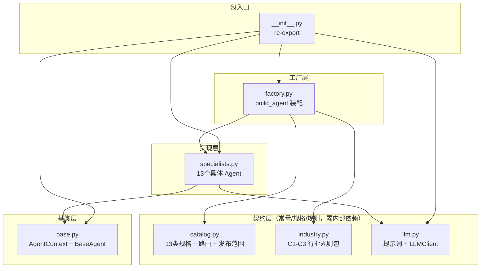

# agents 模块说明

本文件夹是**工业多智能体系统的"专员团队"**：定义 13 类专业子智能体（A1–A5 / B1–B5 / C1–C3），每个智能体职责单一、输出结构化结论，由总指挥（`graph/orchestrator.py`）按事件类型调度。

## 一、设计要点

1. **单一事实来源**：`catalog.py` 是 13 类智能体规格、路由、发布范围的唯一权威定义，其他文件都从这里取数据，不重复硬编码。
2. **规则优先 + LLM 可选降级**：每个智能体先跑确定性规则形成结论；若配置了 LLM（`llm_enabled=True` 且有 API Key），则用 LLM 结构化输出增强，失败/未配置时自动回落到规则结果，**无 LLM 仍可完整运行**。
3. **职责单一、零横向调用**：子智能体之间互不调用，全部由主图节点串联；每个智能体只做自己领域的取证分析，输出 `AgentFinding`。
4. **安全默认**：智能体只输出诊断/建议，**不直接执行控制动作**；控制类动作由执行层（`execution/executor.py`）经五道闸 + 人工确认后才执行。第一版中 A1/B1 被标记为 `first_release_readonly`，其写工具被禁用。
5. **行业注入而非自由协作**：C1–C3 不新增独立协作 Agent，而是以"规则/模板增强包"（`industry.py`）方式注入对应子图，保证行业校验项确定可审计。

## 二、文件清单与作用

| 文件 | 作用 | 类比 |
|------|------|------|
| [`__init__.py`](./__init__.py) | 包入口：re-export 所有公开类与函数（catalog 编号体系 + `factory.build_agent` 装配），不再保留旧版按 name 调度的兼容映射 | 团队花名册 |
| [`base.py`](./base.py) | `AgentContext`（智能体运行时共享上下文）+ `BaseAgent`（所有子智能体的基类，封装审计、工具调用、LLM 降级） | 员工手册 + 工牌模板 |
| [`catalog.py`](./catalog.py) | **13 类智能体的唯一事实来源**：规格（编号/名称/工具/输入输出/风险上限…）、incident_type 路由、行业注入映射、知识库归属、第一版收敛范围 | 组织架构图 + 排班表 |
| [`factory.py`](./factory.py) | `build_agent(code)`：按 catalog 编号把规格装配成可运行的 Agent 实例；C1–C3 走行业规则注入，未知编号回落到 B3 | 人事派工 |
| [`industry.py`](./industry.py) | C1–C3 行业专用规则包（轨道/航空/快速换型）：校验项、确认边界、工艺模板提示 | 行业合规清单 |
| [`llm.py`](./llm.py) | 提示词模板 + `LLMClient`（LangChain 结构化输出，未启用/失败返回 None 走规则降级） | 外援顾问（可选） |
| [`specialists.py`](./specialists.py) | 13 类子智能体的具体实现，每个继承 `BaseAgent` 并重写 `_analyze` | 各专员的实际工作 |

## 三、文件之间的协作关系



调用链（一次事件中智能体是怎么被跑起来的）：

```
graph/orchestrator.py
   │  1. 按 incident_type 查 catalog.resolve_codes() → 得到要跑的 agent 编号列表
   ▼
catalog.py ──返回──► ["B3", "A3", ...]
   │
   ▼  2. factory.build_agent(code) 逐个装配
factory.py ──查 CODE_AGENT_CLASS / industry.rule_pack──► 实例化 BaseAgent 子类
   │
   ▼  3. 对每个实例调用 agent.analyze(ctx)
specialists.py ──_analyze──► 调 tools 取数 + 可选 LLM 增强 ──► AgentFinding
   │                    │
   │                    ▼
   │              base.py（审计留痕 / _call 工具调用 / _llm_finding 降级）
   ▼
返回 AgentFinding 列表给主图节点
```

## 四、13 类智能体速览

### A 系列：人工智能 + 制造（装备侧）

| 编号 | name | 标题 | 第一版 | 职责 |
|------|------|------|--------|------|
| A1 | station_assembly | 工位装配智能体 | ✅ 只读 | 工位工单/设备/物料/批次取数（E-SOP 加载与码绑定写入已禁用） |
| A2 | material_delivery | 物料配送智能体 | ❌ | 缺料判断与配送建议 |
| A3 | quality_trace | 质量追溯智能体 | ✅ | 查询检验结果、不良代码与追溯链 |
| A4 | line_dispatch | 产线调度智能体 | ❌ | 瓶颈识别与动态调度建议 |
| A5 | training_teaching | 实训教学智能体 | ❌ | 独立链路：评分与能力画像 |

### B 系列：人工智能 + 软件（软件侧）

| 编号 | name | 标题 | 第一版 | 职责 |
|------|------|------|--------|------|
| B1 | assembly_entry | 装配智能体入口 | ✅ 只读 | 工艺问答与 E-SOP 检索（不自动加载、不写履历） |
| B2 | logistics_service | 物流智能体服务 | ❌ | 库存与配送路径建议 |
| B3 | control_center | 智能管控大模型服务 | ✅ | **主分析脑**：跨设备/工单/物料/批次/质量取证据 |
| B4 | quality_trace_service | 质量追溯智能体服务 | ✅ | 服务级追溯报告与根因辅助 |
| B5 | training_service | 实训智能体服务 | ❌ | 服务化评分与画像 |

### C 系列：行业专用（两框架融合，规则注入）

| 编号 | 标题 | 第一版 | 注入方式 |
|------|------|--------|----------|
| C1 | 轨道装备多品种小批量装配 | ❌ | 规则包注入 equipment / quality 子图 |
| C2 | 航空高可靠装配与检测 | ❌ | 规则包注入 quality / query 子图 |
| C3 | 新产品导入快速换型 | ❌ | 规则包注入 production / query 子图 |

> **第一版最小可用范围**（`FIRST_RELEASE_CODES`）：A1、A3、B1、B3、B4。其中 A1/B1 仅只读取证，禁止触发写动作。若路由收敛后没有分析主脑（B3/A3/B4），统一回落到 B3 只读诊断，保证编排不断链。

## 五、关键公共概念

- **`AgentContext`**（`base.py`）：智能体运行时的共享上下文，包含当前事件 `incident`、工具注册表 `tools`、知识库 `knowledge`、LLM 客户端、以及本次运行累积的 `tool_results` / `knowledge_hits`。主图节点在调用智能体前构造并传入。
- **`BaseAgent.analyze`**：模板方法，先调子类 `_analyze` 得到结论，再自动写审计记录；子类只需实现 `_analyze`。
- **`BaseAgent._call`**：统一的工具调用入口，走 `ToolRegistry` 九步检查链，并把结果缓存进 `ctx.tool_results` 供 LLM 增强使用。
- **`BaseAgent._llm_finding`**：可选 LLM 增强，若返回非 None 则直接采用 LLM 结论，否则用规则结果。
- **`AgentFinding`**（`models/findings.py`）：所有智能体的统一输出结构，含 summary / findings / hypotheses / evidence / knowledge_refs / confidence / data_gaps / risk_notes / suggested_next_steps。

## 六、扩展指南

- **新增一个智能体**：在 `catalog.py` 的 `AGENT_CATALOG` 加一条 `AgentSpec` → 在 `specialists.py` 加一个继承 `BaseAgent` 的类实现 `_analyze` → 在 `factory.py` 的 `CODE_AGENT_CLASS` 注册编号到类的映射 → 视情况在 `catalog.py` 的 `ROUTE_AGENT_MAP` 里把它挂到对应 `incident_type` 路由。
- **新增行业规则**：在 `industry.py` 的 `INDUSTRY_RULE_PACKS` 加一条 → 在 `catalog.py` 的 `INDUSTRY_INJECTION` 里指定它注入哪个子图。
- **修改第一版范围**：只改 `catalog.py` 里各 `AgentSpec` 的 `first_release` / `first_release_readonly` 字段，`FIRST_RELEASE_CODES` 会自动推导。