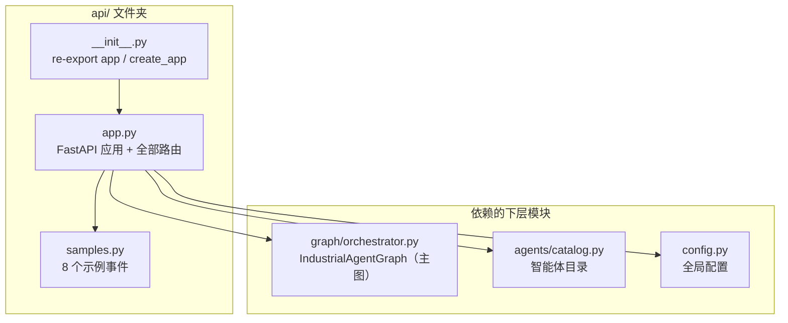

# api 模块说明

本文件夹是**工业多智能体系统的对外服务窗口**：用 FastAPI 暴露事件接入、单 Agent 模拟、端到端编排、人工确认回调、审计查询等接口，生产期还同源托管前端构建产物（`frontend/dist`）。

## 一、设计要点

1. **统一 `/api` 前缀**：所有后端接口都挂在 `/api` 下，与前端静态资源路由天然隔离，避免 SPA 路由与 API 路由冲突。
2. **开发/生产双模式**：开发期前端由 Vite（5173 端口）单独启动，通过代理转发 `/api` 到本服务（8000 端口）；生产期 `npm run build` 生成 `frontend/dist`，由 FastAPI 同源托管，SPA 路由走 `/{full_path:path}` 回退到 `index.html`。
3. **单 Agent 模拟与端到端编排分离**：
   - `/api/agents/{code}/run` 只跑单个智能体（复用归一化/治理/知识检索逻辑，返回完整上下文），用于前端逐个模拟观察；
   - `/api/events` 跑完整 14 节点主图，用于端到端编排。
4. **人工确认闭环**：主图在高风险动作处用 LangGraph `interrupt` 挂起，前端调 `/api/confirms/{thread_id}` 恢复执行；确认结果由 `execution/executor.py` 的 `ConfirmStore` 管理（TTL 3600s，超时即过期，严禁默认同意）。
5. **CORS 白名单**：仅放行本地 5173/8000 端口，生产部署需按实际域名调整 `ALLOWED_ORIGINS`。

## 二、文件清单与作用

| 文件 | 作用 | 类比 |
|------|------|------|
| [`__init__.py`](./__init__.py) | 包入口：re-export `app` 与 `create_app`，让外部直接 `from industrial_agent.api import app` 启动服务 | 接待台名片 |
| [`app.py`](./app.py) | **FastAPI 应用主体**：定义请求模型、装配主图实例、注册全部接口（系统信息 / 智能体目录 / 单 Agent 模拟 / 工具样本 / 端到端编排 / 人工确认 / 审计 / 前端静态托管） | 服务窗口的全部业务 |
| [`samples.py`](./samples.py) | 8 个覆盖 7 种 incident_type 的示例事件报文，供前端一键加载测试（单 Agent 模拟 + 端到端编排两个视图共用） | 测试用的样板工单 |

## 三、文件之间的协作关系



调用链（一次端到端请求的完整路径）：

```
前端 POST /api/events  {event, thread_id}
   │
   ▼
app.py: ingest() ──调用──► agent.run(event, thread_id)
   │                         │
   │                         ▼
   │              graph/orchestrator.py（14 节点主图）
   │              ├─ ingestion 归一化
   │              ├─ governance 治理
   │              ├─ knowledge 检索
   │              ├─ agents 并发取证（catalog 路由 + factory 装配）
   │              ├─ planning 生成方案
   │              ├─ execution 执行（高风险处 interrupt 挂起）
   │              └─ record/respond 返回 final_answer
   │
   ▼ 若高风险动作被 interrupt 挂起
前端 GET /api/confirms/pending → 看到待确认项
前端 POST /api/confirms/{thread_id} {approved, decision_by, ...}
   │
   ▼
app.py: confirm() ──调用──► agent.resume(thread_id, {...}) → 继续执行剩余节点
   │
   ▼
返回最终状态（经 _sanitize_state 处理 __interrupt__ 后可 JSON 序列化）
```

## 四、接口清单

### 系统信息

| 方法 | 路径 | 作用 |
|------|------|------|
| GET | `/api/health` | 健康检查，返回状态 / 环境 / 租户 |
| GET | `/api/settings` | 运行时配置（灰度模式 / 发布范围 / LLM 是否启用等） |
| GET | `/api/graph` | 主图节点清单（供前端绘制编排图，来自 `orchestrator.graph_nodes`） |

### 智能体目录与单 Agent 模拟

| 方法 | 路径 | 作用 |
|------|------|------|
| GET | `/api/agents` | 13 类智能体清单（含规格 + 是否只读 + 工具详情） |
| GET | `/api/agents/{code}` | 单个智能体详情 |
| POST | `/api/agents/{code}/run` | **单 Agent 模拟**：只跑指定智能体，返回取证结论/工具调用/知识检索 |

### 工具 / 样本

| 方法 | 路径 | 作用 |
|------|------|------|
| GET | `/api/tools` | 工具目录（17 个默认工具的元数据） |
| GET | `/api/samples` | 示例事件列表（仅 key/label/incident_type，不含完整报文） |
| GET | `/api/samples/{key}` | 单个示例事件的完整原始报文（异构格式，归一化前） |

### 端到端编排

| 方法 | 路径 | 作用 |
|------|------|------|
| POST | `/api/events` | 接入事件，跑完整 14 节点主图 |
| POST | `/api/confirms/{thread_id}` | 人工确认回调，恢复被 interrupt 挂起的执行 |
| GET | `/api/confirms/pending` | 当前待确认项列表 |
| GET | `/api/incidents/open` | 当前未关闭的事件列表（治理层） |
| GET | `/api/audit/{trace_id}` | 按 trace_id 回放整条审计链路 |

### 前端静态托管（生产）

| 方法 | 路径 | 作用 |
|------|------|------|
| GET | `/{full_path:path}` | 回退路由：存在静态文件则返回，否则返回 `index.html` 支持 SPA；`frontend/dist` 不存在时返回 404 提示 |

## 五、关键公共概念

- **`create_app(graph=None)`**：应用工厂。不传 `graph` 时内部用 `get_settings()` 新建一个 `IndustrialAgentGraph`；传 `graph` 时用于测试注入（可替换主图实例）。这是 FastAPI 测试的标准模式——可在单测里传入 mock graph 而不启动真实服务。
- **`_sanitize_state(result)`**：把 LangGraph 返回的状态字典转成可 JSON 序列化的形态，重点处理 `__interrupt__` 字段（LangGraph 的 interrupt 对象不能直接序列化，需取出 `.value`）。
- **`_agent_info(agent, code)`**：把 catalog 规格 + 只读标记 + 工具详情拼成前端所需的智能体信息结构，`/api/agents` 和 `/api/agents/{code}` 共用。
- **`app.state.agent` / `app.state.settings`**：FastAPI 的应用状态，把主图实例和配置挂在 app 上，各路由通过闭包直接访问。
- **`EventIn` / `AgentRunIn` / `ConfirmIn`**：三个 Pydantic 请求模型，分别对应事件接入、单 Agent 模拟、人工确认三种入参。

## 六、扩展指南

- **新增接口**：在 `app.py` 的 `create_app` 内按分组加 `@app.xxx` 路由即可；路由逻辑应尽量薄，把业务委托给 `agent`（主图实例）或下层模块，api 层只做参数校验与响应封装。
- **新增示例事件**：在 `samples.py` 的 `SAMPLE_EVENTS` 列表追加一条 dict（含 key/label/incident_type/event），前端样本下拉框会自动出现。
- **生产部署调整**：修改 `ALLOWED_ORIGINS` 为实际前端域名；确保 `frontend/dist` 已构建（`cd frontend && npm run build`）；用 `uvicorn industrial_agent.api:app --host 0.0.0.0 --port 8000` 启动。