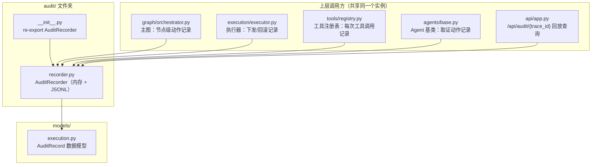

# audit 模块说明

本文件夹是**审计与可观测层**：为主图全链路的每一个关键动作（工具调用、人工确认、执行下发、治理决策等）留痕，支持按 `trace_id` 回放整条事件的处理轨迹，满足工业场景对"谁、在什么角色、对什么目标、做了什么、是否被批准、为什么"的可审计要求。

## 一、设计要点

1. **双重存储：内存 + JSONL 落盘**：
   - 内存 `list[AuditRecord]` 用于进程内快速查询（`replay` 按 trace_id 过滤）；
   - JSONL 落盘用于持久化与跨进程/重启后保留，按天切分文件 `audit-YYYYMMDD.jsonl`，便于按日期归档与合规留存。
2. **幂等追加、不可变记录**：每条 `AuditRecord` 生成后不再修改，`audit_id`（`aud-` + 12 位 hex）全局唯一，`created_at` 用 UTC 时间，保证时序与追溯确定性。
3. **单一写入入口 `record()`**：所有调用方（主图 / 执行器 / 工具注册表 / Agent 基类）都通过同一个 `AuditRecorder` 实例的 `record()` 落库，字段口径统一，不允许各自造记录。
4. **实例注入而非全局单例**：`AuditRecorder` 不做模块级单例，而是由 `IndustrialAgentGraph` 创建后注入到 executor、tools、agents 中（构造参数 `audit=`）。测试时可传入无落盘的内存实例（`audit_dir=None`），避免污染磁盘。
5. **决策语义闭环**：`decision` 字段用枚举字面量 `allowed / denied / confirmed / rejected / executed / rolled_back`，覆盖从治理放行→人工确认→执行→回滚的完整决策链，回放时能还原每个动作的审批状态。

## 二、文件清单与作用

| 文件 | 作用 | 类比 |
|------|------|------|
| [`__init__.py`](./__init__.py) | 包入口：re-export `AuditRecorder`，让外部直接 `from industrial_agent.audit import AuditRecorder` | 接待台名片 |
| [`recorder.py`](./recorder.py) | **审计记录器主体**：`AuditRecorder` 类，负责记录生成、内存缓存、JSONL 按天落盘、按 trace_id 回放、JSON 导出与清空 | 全程录像的黑匣子 |

数据模型 `AuditRecord` 定义在 [`models/execution.py`](../models/execution.py)（不属于本文件夹，但被本模块依赖），本模块只负责"写入与查询"，不负责"定义记录长什么样"。

## 三、文件之间的协作关系



一次端到端的审计留痕与回放：

```
事件进入主图（trace_id = T001）
   │
   ├─ ingestion 节点        → audit.record(actor="ingestion", action="normalize", ...)
   ├─ governance 节点       → audit.record(actor="governance", action="risk_check",
   │                           decision="allowed", risk_level="high", ...)
   ├─ agents 并发取证       → 各 Agent 调工具 → tools 注册表
   │                           audit.record(actor="tool:xxx", action="call", input_snapshot=..., ...)
   ├─ execution 节点        → 高风险动作 interrupt 挂起
   │                           人工确认 → audit.record(actor="user:张三", decision="confirmed", roles=["工艺主管"], ...)
   │                           执行下发 → audit.record(actor="executor", decision="executed", target="DEVICE-A-001", ...)
   └─ respond 节点          → audit.record(actor="respond", action="final_answer", ...)
   │
   ▼ 回放
前端 GET /api/audit/T001
   │
   ▼
api/app.py → agent.audit.replay("T001") → 按时间顺序返回上述全部记录
```

## 四、关键公共概念

- **`AuditRecorder(audit_dir=None, *, echo=False)`**：构造器。`audit_dir` 为 `None` 时只存内存不落盘（测试用）；传目录则自动 `mkdir(parents=True, exist_ok=True)` 并按天写 JSONL。`echo` 保留参数（当前未使用，预留给控制台回显）。
- **`record(...)`**：唯一写入入口，关键字参数强制显式传名，避免位置参数错位。自动填充 `audit_id`（`aud-` + `uuid4` 前 12 位 hex）和 `created_at`（UTC now）。
- **`AuditRecord` 关键字段**：
  - `trace_id`：全链路关联键，一条事件的所有记录共享同一个 trace_id，回放的主键；
  - `actor` / `roles`：谁（智能体节点名 / 用户标识）、以什么角色执行；
  - `action` / `target`：做了什么、对哪个对象（如 `DEVICE-A-001`）；
  - `input_snapshot` / `output_snapshot`：动作前后的状态快照（脱敏后），用于事后排查；
  - `risk_level`：风险等级（high/medium/low），高风险动作必须有人工确认记录；
  - `decision`：决策结果，取值见 `AuditDecision`；
  - `reason`：决策理由（如规则命中、LLM 结论、人工备注）。
- **`replay(trace_id)`**：按 trace_id 过滤内存记录，返回 `list[AuditRecord]`（保持插入顺序，即时间顺序）。注意：只查内存，重启后内存丢失需直接读 JSONL 文件（当前版本未实现磁盘回放，是已知限制）。
- **`dump_json(trace_id)`**：把某条 trace 的记录导出为格式化 JSON 字符串（`ensure_ascii=False` 保留中文），便于导出报告或复制给评审。

## 五、扩展指南

- **新增审计字段**：先在 `models/execution.py` 的 `AuditRecord` 加字段（带默认值，向后兼容），再在 `record()` 加同名关键字参数；已有 JSONL 文件用旧格式不影响读取（Pydantic 忽略多余字段、缺失字段用默认值）。
- **磁盘回放**：当前 `replay` 只读内存。如需跨重启回放，可新增 `replay_from_disk(trace_id)`：扫描 `audit_dir` 下所有 `audit-*.jsonl`，逐行 `AuditRecord.model_validate_json` 后过滤 trace_id。
- **接入外部审计系统**：继承 `AuditRecorder` 重写 `_append_jsonl`，或在 `record()` 后追加发送到 Kafka/数据库的钩子；保持 `record()` 签名不变即可被所有调用方无缝复用。
- **日志轮转/留存策略**：JSONL 按天切分，若需按大小切分或定期清理旧文件，可在 `_append_jsonl` 增加轮转逻辑，或用外部定时任务归档。