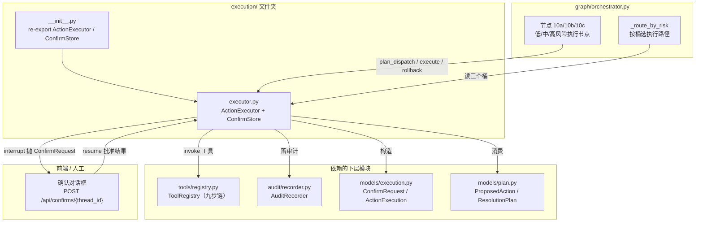

# execution 模块说明

本文件夹是**执行与人工确认闭环层**：承接主图节点 10 的调用，把规划层（plan）生成的处置方案真正落到工具执行上，并通过"三分桶分流 + 前置五道闸 + 人工确认闭环 + 失败回滚 + 全链路审计"保证全过程安全可控。这是系统中**唯一会真正调用写工具、触发现实动作**的地方，安全约束最密集。

## 一、设计要点

1. **三分桶分流（`plan_dispatch`）**：按风险把方案动作拆进三个桶——
   - `auto`：低风险（`risk_level=low`），主图自动执行；
   - `todo`：中风险（`medium`），灰度模式决定自动执行还是转人工待办；
   - `confirm`：高风险（`high`）或显式 `requires_human_confirm=True`，**必须人工确认**后才能执行。
   主图的 `_route_by_risk` 就是按这三个桶的内容选择执行节点（低/中/高风险三条路径）。

2. **前置五道闸（`execute`）**：执行层的独立安全闸，与工具层（`ToolRegistry` 九步链）、方案层（`PlanValidator`）共同构成"三道闸"纵深防御。任一闸不通过直接返回 `failed`，**绝不调工具**：
   1. 幂等校验：同一 `incident_id + action_id` 已执行过 → `DUPLICATE_EXECUTION`；
   2. 高风险确认：`risk_level=high` 必须有有效且 `approved` 的 `confirm_id` → `CONFIRM_REQUIRED` / `CONFIRM_INVALID`；
   3. 可执行性：`action.executable=False` → `NOT_EXECUTABLE`；
   4. 工具绑定：`action.tool_name` 为空 → `NO_TOOL_BOUND`；
   5. 工具调用：通过后才调 `tools.invoke`（工具层九步链在此生效），结果落记录。
   > 关键：高风险动作即便主图节点 10c 已批准，`execute` 仍会再次校验 `confirm_id` 状态，防止"批准后确认被过期/撤销仍被执行"的竞态。

3. **人工确认闭环（`ConfirmStore`）**：高风险动作必经之路，三条安全铁律：
   - **TTL 超时**（默认 3600s）：超时自动置 `expired`，严禁默认同意；
   - **角色校验（RBAC）**：批准人必须具备动作要求的**全部** `required_roles`，缺一不可；
   - **不可重复决策**：已 `approved/rejected/expired` 的请求不允许再次决策，防止同一请求被批准两次。
   `confirm_id` 是连接"请求 → 批准 → 执行"的纽带，也是审计追溯的关联键。

4. **失败回滚（`rollback`）**：执行失败后按 `action.rollback_hint` 尝试回滚；有可用回滚方案标记 `rolled_back`，无方案则标记 `failed` 带 `NO_ROLLBACK_PLAN`，升级人工紧急处理。当前回滚为"标记 + 提示"，真正的反向工具调用可在此扩展。

5. **全链路审计**：每一步——确认请求创建（`confirm:request`）、执行意图（`execution:intent`）、执行结果（`execution:result`）、回滚（`execution:rollback`）——都落 `AuditRecorder`，保证"谁、以什么角色、对什么目标、做了什么、是否被批准、为什么"可追溯。

## 二、文件清单与作用

| 文件 | 作用 | 类比 |
|------|------|------|
| [`__init__.py`](./__init__.py) | 包入口：re-export `ActionExecutor` 与 `ConfirmStore`，让外部直接 `from industrial_agent.execution import ActionExecutor` | 接待台名片 |
| [`executor.py`](./executor.py) | **执行层主体**：`ConfirmStore`（确认请求存储 + TTL + 角色校验）+ `ActionExecutor`（三分桶 / 五道闸 / 执行 / 回滚 / 审计） | 带安检闸的动作执行台 |

> 本模块**只负责"执行与确认逻辑"**，数据结构定义在别处：
> - `ConfirmRequest` / `ActionExecution` 定义在 [`models/execution.py`](../models/execution.py)；
> - `ProposedAction` / `ResolutionPlan`（方案动作与方案）定义在 [`models/plan.py`](../models/plan.py)；
> - `ToolContext` / `ToolResult` 定义在 [`tools/contracts.py`](../tools/contracts.py)。

## 三、文件之间的协作关系



一次高风险动作的完整闭环：

```
规划层生成 ResolutionPlan（含 N 个 ProposedAction）
   │
   ▼ 节点 10：plan_dispatch 三分桶
   ├─ auto 桶（low）   → 节点 10a 自动 execute（五道闸 → 调工具）
   ├─ todo 桶（medium）→ 节点 10b 灰度决定 execute 或转待办
   └─ confirm 桶（high）→ 节点 10c request_confirmations：
                          为每个高风险动作创建 ConfirmRequest（status=pending，TTL=1h）
                          → 落审计 confirm:request
                          → LangGraph interrupt() 把请求抛给前端
                          ⏸ 挂起，等待人工
   │
   ▼ 前端弹出确认对话框
   用户 POST /api/confirms/{thread_id} {approved, decision_by, roles, note}
   │
   ▼ ConfirmStore.decide() 四步校验
   1. 请求存在？  2. 状态 pending？  3. 未超时？  4. 具备全部 required_roles？
   ├─ 任一不通过 → 返回 ok=False → 主图拒绝执行，落审计 denied
   └─ 全部通过   → status=approved → 主图 resume 继续
   │
   ▼ 节点 10c 继续执行 execute(confirm_id=...)
   五道闸再次校验（含 confirm_id 仍为 approved）→ 通过 → 调工具 → 落执行记录 + 审计 executed
   │
   ▼ 若工具执行失败
   rollback() → 有 rollback_hint 则 rolled_back，否则 NO_ROLLBACK_PLAN 升级人工
```

## 四、关键公共概念

- **`ConfirmStore(ttl_seconds=3600)`**：确认请求存储（内存 dict）。核心方法：
  - `create(plan, action, required_roles)` → 生成 `confirm_id`（`cfm-` + 10 位 hex），`expire_at = now + ttl`；
  - `get(confirm_id)` → 取请求，不存在返回 `None`；
  - `list_pending()` → 前端待办列表数据源；
  - `expire_overdue()` → 定时扫描把超时的 pending 置 expired；
  - `decide(confirm_id, approved, decision_by, roles, note)` → 返回 `(ok, status)`，`ok=False` 表示确认无效，调用方**必须**拒绝执行。

- **`ConfirmRequest` 状态机**（`ConfirmStatus`）：
  ```
  pending ──decide(approved=True)──► approved ──execute成功──► executed
      │                                │
      ├──decide(approved=False)──► rejected
      ├──超时/expire_overdue()──► expired
      └──execute失败──► failed
  ```

- **`ActionExecutor(tools, *, audit=None, confirms=None)`**：执行器。`tools` 必传（工具注册表），`audit`/`confirms` 不传则各自新建默认实例（内存 + JSONL / TTL 3600s）。主图会把同一个 `AuditRecorder` 和 `ConfirmStore` 注入进来，保证全链路共享。

- **幂等键**：`f"{incident_id}:{action_id}"`，存于 `_executed_keys` 集合。工具调用返回后才加入集合（即便失败也算"执行过"），避免重试无限循环；同时把同一个 key 作为 `idempotency_key` 传给工具层，工具层也做幂等缓存。

- **错误码**（`ActionExecution.error_code`）：
  | 错误码 | 含义 | 触发闸 |
  |--------|------|--------|
  | `DUPLICATE_EXECUTION` | 同一 incident+action 重复执行 | 闸 1 幂等 |
  | `CONFIRM_REQUIRED` | 高风险动作缺少 confirm_id | 闸 2 |
  | `CONFIRM_INVALID` | confirm_id 不存在/非 approved（可能已过期被拒） | 闸 2 |
  | `NOT_EXECUTABLE` | 动作被标记为不可执行（仅人工提示） | 闸 3 |
  | `NO_TOOL_BOUND` | 动作未绑定工具 | 闸 4 |
  | `NO_ROLLBACK_PLAN` | 执行失败且无回滚方案 | rollback |

- **`ActionExecution`（执行结果记录）**：`execution_id`（`exe-` + 10 位 hex）、`status`（`success/failed/partial/rolled_back`）、`tool_args_snapshot`（执行时参数快照，事后排查）、`rollback_executed`（是否已回滚）、`operator`（执行者，`system` 或用户标识）。

## 五、扩展指南

- **新增回滚实现**：当前 `rollback()` 只做标记 + 提示。若需真正反向调用工具，可在 `rollback_ok` 分支里解析 `rollback_hint`、构造反向 `ProposedAction`、调 `self._tools.invoke` 执行，并在审计里记录回滚的工具调用详情。
- **持久化 ConfirmStore**：当前确认请求存内存，进程重启会丢失（pending 请求需重新发起）。若需跨重启保留，可把 `ConfirmStore` 的 dict 换成数据库/Redis，并在 `create`/`decide` 时持久化。
- **接入外部审批流**：`decide()` 的角色校验目前只比对 `required_roles ⊆ roles`。若需对接企业 RBAC/审批系统，可在角色校验处调用外部接口查询用户真实角色，替换本地比对逻辑。
- **动态 TTL**：当前所有确认请求统一 3600s。若不同风险/动作需要不同超时，可在 `create()` 增加 `ttl_override` 参数，按 `risk_level` 映射（如 critical → 600s）。
- **执行限流/并发控制**：当前同一动作靠幂等键防重，但不同动作可并发。若需对某类工具（如设备控制）做串行化或并发上限，可在 `execute` 调工具前增加并发闸门。