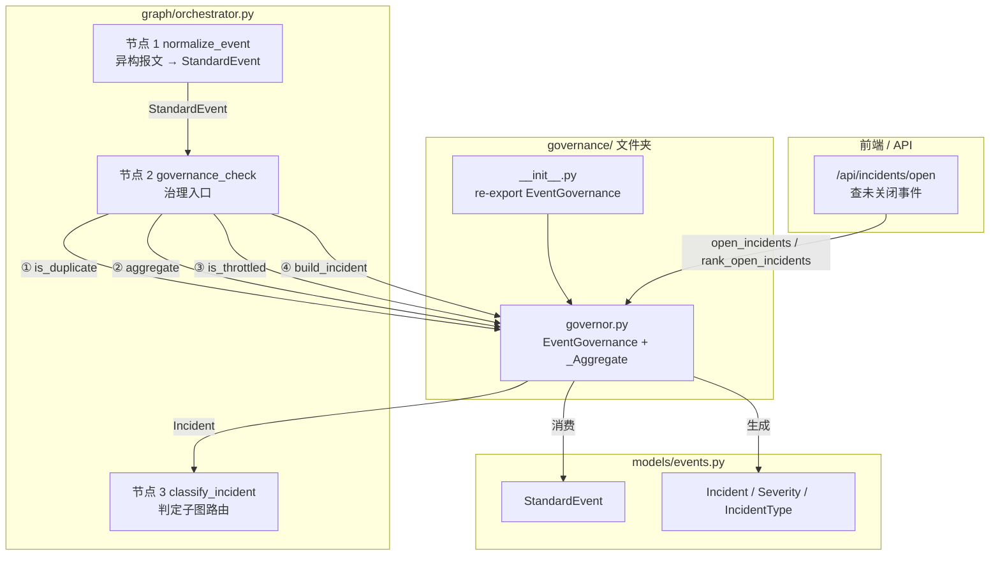

# governance 模块说明

本文件夹是**事件治理层**：位于主图节点 1（归一化）之后、节点 3（分类）之前，把上游涌入的标准事件流（`StandardEvent`）治理为有序、可调度的问题实例流（`Incident`）。它解决工业现场"事件风暴"问题——同一故障会从 EAM/MES/QMS 等多个系统反复推送、同一产线多个设备同时报警，如果不治理就会把下游智能体淹没。

## 一、设计要点

1. **去重（`is_duplicate`）**：同一 `idempotency_key` 在去重窗口（默认 300s）内重复到达的事件只保留首条，其余丢弃并累加 `dup_counter`。`idempotency_key` 由归一化层从上游报文生成（通常是 `event_id` 或业务主键的稳定哈希），保证上游重试/多通道推送不会被重复处理。
2. **聚合（`aggregate` + `aggregate_key`）**：把语义相关的多条事件合并成一个 `Incident`。聚合键按优先级取 `device+alarm_code` → `work_order+process` → `batch+alarm/event_type` → 兜底 `misc:idempotency_key`。聚合时持续更新：事件数、首末发生时间、最高严重度、实体引用、受影响产线、安全/高影响标记。若同聚合内出现不同 incident_type，降级为 `mixed_exception`（触发最完整的取证链路）。
3. **限流（`is_throttled`）**：两道限流闸——全局并发上限（默认 8 个未关闭 Incident）+ 单实体上限（默认同一 device/wo/batch 最多 2 个）。超限的 Incident 进入等待，不立即调度下游，避免智能体过载。
4. **优先级评分（`priority_score`）**：综合 5 个维度算分，`rank_open_incidents` 据此排序：
   - 严重度权重（low=1 / medium=3 / high=6 / critical=10）；
   - 事件数（每多 1 条 +0.5，封顶 5 条）；
   - 受影响产线数（每多 1 条 +1，封顶 3）；
   - 高影响关键词（停线/批量/召回，+2）；
   - 安全关键词（人身/火灾/泄漏/停线，+3）——**安全优先是最高加权项**；
   - 等待时长（每分钟 +0.5×wait_weight，封顶 10min），防止低优事件饥饿。
5. **事件类型路由推导（`_incident_type`）**：按 `event_type` 的前缀（mes/wms/qms/eam/query/esop/manual/training/edu）映射到 7 种 `incident_type`，决定下游路由到哪条子图（catalog 三级路由的第一级）。前缀无法识别时回落到 `source_system`，再不行兜底 `mixed_exception`。
6. **实例化注入**：`EventGovernance` 不做全局单例，由主图创建并注入，参数（去重窗口/并发上限/单实体上限/等待权重）全部来自配置，测试时可传自定义值或 `reset()` 清状态做隔离。

## 二、文件清单与作用

| 文件 | 作用 | 类比 |
|------|------|------|
| [`__init__.py`](./__init__.py) | 包入口：re-export `EventGovernance`，让外部直接 `from industrial_agent.governance import EventGovernance` | 接待台名片 |
| [`governor.py`](./governor.py) | **治理层主体**：`EventGovernance` 类（去重/聚合/限流/优先级/Incident 生命周期）+ 内部 `_Aggregate` 累加器 + 权重/映射/关键词常量 | 事件调度的交通警察 |

> 本模块**只负责"治理逻辑"**，数据结构定义在别处：
> - `StandardEvent`（归一化后的标准事件）定义在 [`models/events.py`](../models/events.py)；
> - `Incident` / `Severity` / `IncidentType` 也定义在 `models/events.py`。

## 三、文件之间的协作关系



一次事件的治理全流程（主图节点 2 内部）：

```
上游事件经节点 1 归一化为 StandardEvent（含 idempotency_key / trace_id / event_type / 实体引用）
   │
   ▼ ① 去重 is_duplicate(event)
   ├─ 窗口内已见过该 idempotency_key → dup_counter+1，返回最终结论"重复已收敛"，不进下游
   └─ 未见 / 窗口外 → 记下 last_seen，继续
   │
   ▼ ② 聚合 aggregate(event)
   取 aggregate_key（device+alarm → wo+process → batch → misc）
   新建或更新 _Aggregate：累加 event_ids、更新首末时间、取最高 severity、
   合并 entity_refs、affected_lines、检测安全/高影响关键词、推导 incident_type
   │
   ▼ ③ 限流 is_throttled(agg)
   ├─ 全局未关闭 Incident ≥ 上限（8） → 等待，原因"全局并发达到上限"
   ├─ 该实体（device/wo/batch）未关闭 Incident ≥ 上限（2） → 等待
   └─ 未超限 → 继续
   │
   ▼ ④ 生成 Incident build_incident(agg)
   生成 incident_id（inc- + 10位hex），算 priority_score，status="new"
   登记进 _open_incidents 与 _entity_open（用于限流统计）
   │
   ▼ 交给节点 3 classify_incident → 按 incident_type 路由子图 → 下游智能体取证
   │
   ▼ 事件处理完毕
   主图调 close_incident(incident_id) 关闭，从 _open_incidents / _entity_open 移除，释放限流额度
```

## 四、关键公共概念

- **`_Aggregate`（内部累加器，dataclass）**：聚合过程中的中间态，不对外暴露。聚合完成后由 `build_incident` 转成对外的 `Incident`。字段：`trace_id`、`event_ids`、`first/last_occurred_at`、`max_severity`、`incident_type`、`entity_refs`、`affected_lines`、`safety_related`、`high_impact`、`first_seen_at`（优先级等待时长的起点）。

- **模块级常量**：
  | 常量 | 作用 |
  |------|------|
  | `SEVERITY_WEIGHT` | 严重度 → 优先级权重（critical=10 最高） |
  | `SEVERITY_RANK` | 严重度 → 排序序号，用于取 max_severity |
  | `INCIDENT_TYPE_BY_EVENT_PREFIX` | event_type 前缀 → incident_type 路由映射（含 query/standalone 独立链路） |
  | `SAFETY_KEYWORDS` | 安全关键词（人身/火灾/泄漏/停线等），命中则 safety_related=True，优先级 +3 |
  | `HIGH_IMPACT_KEYWORDS` | 高影响关键词（停线/批量/召回等），命中则 high_impact=True，优先级 +2 |

- **`aggregate_key(event)`**：聚合键生成。优先级：`device_id + alarm_code`（最精确，同设备同报警） → `work_order_id + process_id`（同工单同工序） → `batch_id + alarm_code/event_type`（同批次） → 兜底 `misc:idempotency_key`。选择逻辑体现"同一物理故障应聚到一起"的意图。

- **`priority_score` 公式**：
  ```
  score = SEVERITY_WEIGHT[max_severity]
        + min(event_count, 5) * 0.5
        + min(affected_lines - 1, 3) * 1.0     # 仅当有受影响产线
        + (high_impact ? 2.0 : 0)
        + (safety_related ? 3.0 : 0)
        + min(waited_minutes, 10) * wait_weight
  ```
  安全加权（+3）高于严重度 high（+6 到 critical 10 的差距）但远高于高影响（+2），体现工业场景"人身安全优先于产能"。

- **Incident 生命周期**（`IncidentStatus`）：`new`（刚生成） → `processing`（下游处理中） → `waiting_confirm`（高风险动作挂起等人工） → `closed`（完成）或 `failed`（失败）。`close_incident` 关闭时会从 `_entity_open` 各集合移除，释放限流额度。

- **限流与优先级的配合**：限流决定"能不能现在调度"，优先级决定"多个等待中的 Incident 先调度谁"。`rank_open_incidents` 按 `priority_score` 降序返回，主图调度器从队首取。

## 五、扩展指南

- **持久化治理状态**：当前 `_aggregates` / `_open_incidents` 存内存，进程重启丢失。若需跨重启保留，可把这些 dict 换成数据库/Redis，并在 `aggregate`/`build_incident`/`close_incident` 时持久化。
- **动态聚合键**：当前聚合键规则固定。若某些行业场景需要按 `material_id` 或自定义字段聚合，可在 `aggregate_key` 增加分支，或从配置注入聚合维度列表。
- **更丰富的优先级因子**：如需加入"产线重要性权重""客户 SLA 等级"等，可在 `priority_score` 增加对应项；注意保持量纲（都换算成可比分值），并更新 `SEVERITY_WEIGHT` 等常量的相对关系。
- **限流排队策略**：当前 `is_throttled` 只返回"是否限流 + 原因"，实际排队由主图调度器决定。若需治理层内置优先级队列（而非每次重新 rank），可在此维护一个等待队列，按 `priority_score` 出队。
- **聚合自动关闭**：当前 Incident 关闭靠主图主动调 `close_incident`。若需"长时间无新事件的 Incident 自动关闭"，可新增 `stale_close(now, idle_seconds)` 扫描 `last_occurred_at` 超时的开放 Incident。
- **去重窗口按事件类型区分**：当前全局统一 300s。若不同事件类型重试频率差异大，可把 `dedup_window_seconds` 改成按 incident_type 的映射。