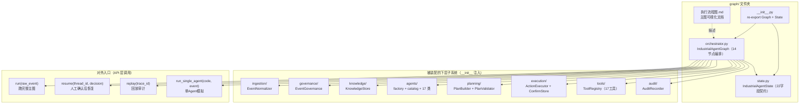
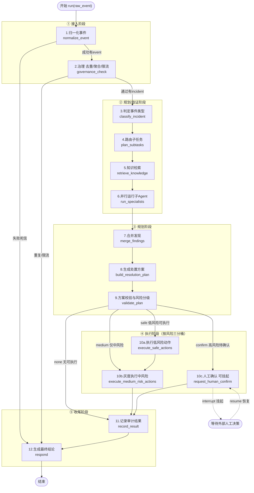

# graph 模块说明

本文件夹是**主调度与编排层**：整个工业多智能体系统的**唯一装配点 + 总指挥**。它把下层所有子系统（归一化 / 治理 / 知识 / 工具 / 智能体 / 规划 / 执行 / 审计）组装在一起，用 LangGraph 的 `StateGraph` 画出 14 节点的确定性流程图，让事件按固定顺序流转，并对外提供 `run` / `resume` / `replay` / `run_single_agent` 四个入口。

> 这是系统的"中枢神经"——所有子系统之间**零横向调用**，全由本层的节点方法串联，保证流程确定、可回放、可人工介入。

## 一、设计要点

1. **确定性 14 节点流程**：节点顺序在 `_build()` 里固定注册，事件从 `START` 流到 `END`，中间只有 4 处条件分支（归一化成败、治理重复/限流、风险路由三分桶），其余线性串接。流程确定 = 可审计、可回放、可测试。
2. **节点间靠 state 传话，互不直接调用**：`IndustrialAgentState`（`TypedDict, total=False`）是节点间唯一的数据契约，节点只回写自己负责的字段，其余保持原值。这正是"流程确定、互不覆盖"的根基。
3. **可中断 / 可恢复（人工确认闭环）**：节点 10c 通过 LangGraph 的 `interrupt()` 挂起图执行，把确认请求抛给前端；外部调 `resume(thread_id, decision)` 从挂起点恢复。`thread_id` 是检查点隔离的纽带。**安全默认**：`decision` 非 dict 或缺 `approved` → 一律视为未批准，严禁默认同意。
4. **所有子系统在 `__init__` 装配一次，之后只读**：构造参数全部可注入（settings / tools / knowledge / governance / audit / llm），便于单元测试替换为内存/桩实现，不污染磁盘。
5. **旁路单 Agent 模拟与主图分离**：`run_single_agent` 是独立旁路（归一化→治理→知识→单 Agent），不进入主图，便于前端逐个观察每个智能体的取证结论，不影响主图状态。
6. **全链路审计贯穿**：几乎每个节点都调 `self._audit.record(...)` 落痕，配合 `replay(trace_id)` 可还原整条事件的处置链路。

## 二、文件清单与作用

| 文件 | 作用 | 类比 |
|------|------|------|
| [`__init__.py`](./__init__.py) | 包入口：re-export `IndustrialAgentGraph` 与 `IndustrialAgentState`，让外部直接 `from industrial_agent.graph import ...` | 接待台名片 |
| [`state.py`](./state.py) | **主图状态契约**：`IndustrialAgentState`（22 字段 TypedDict），定义节点间传递数据的唯一合同 | 各节点间传话的标准化信封 |
| [`orchestrator.py`](./orchestrator.py) | **编排器主体**：`IndustrialAgentGraph` 类——装配所有子系统 + 构建 14 节点流程图 + 实现全部节点逻辑 + 对外 4 个运行入口 | 指挥整场演出的总指挥 |
| [`执行流程图.md`](./执行流程图.md) | 已有的独立文档：`orchestrator.py` 主图 14 节点的可视化流程图（Mermaid），与 `orchestrator.py` 模块 docstring 中的图一致 | 总指挥桌前的流程挂图 |

## 三、文件之间的协作关系

## 四、14 节点主图流程

> 节点详细说明与 Mermaid 源见 [`执行流程图.md`](./执行流程图.md) 与 `orchestrator.py` 模块顶部 docstring。

### 四个条件分支（流程中唯一的"岔路"）

| 分支点 | 路由函数 | 分支 | 去向 |
|--------|----------|------|------|
| 节点 1 之后 | `_route_after_normalize` | 有 event（成功）/ 无 event（死信） | 治理 / 直接 respond |
| 节点 2 之后 | `_route_after_governance` | 重复或限流 / 有 incident | 直接 respond / 判定类型 |
| 节点 9 之后 | `_route_by_risk` | confirm / safe / medium / none | 10c / 10a / 10b / 11 |
| 节点 10a→10b（固定串接） | — | safe 路径先跑低风险再进中风险节点 | — |

**风险路由优先级**：`confirm`（高风险待确认）> `safe`（有可执行低风险）> `medium`（只有中风险）> `none`（无可执行）。注意 safe 路径会先经 10a 再串到 10b，中风险节点内部按灰度策略决定是否真执行。

## 五、关键公共概念

- **`IndustrialAgentState`（state.py）**：节点间数据契约。22 个字段全部可选（`total=False`），节点只回写自己负责的字段。值一律用可序列化基础类型（dict/list/str），不直接放模型对象——保证 state 可被检查点持久化、可回放、可跨进程传输。每个字段的"写入节点 + 用途"在 `state.py` 中有逐字段注释。

- **`IndustrialAgentGraph(settings=None, tools=None, ...)`**：编排器构造。所有参数可注入，不传则用默认（从 `.env` 读配置、装配 17 个默认工具、启动加载知识库、内存+JSONL 审计）。`__init__` 里完成：读配置 → 建灰度策略 → 建审计/工具/知识/治理/LLM → 建规划器/确认存储/执行器 → 建内存检查点 → 调 `_build()` 编译图。

- **`_build()`**：构建流程图。`add_node` 注册 14 个节点（id → 节点方法），`add_edge` 连线，`add_conditional_edges` 注册 4 处条件分支，`compile(checkpointer=...)` 挂内存检查点使 `interrupt()` 可用。

- **节点方法约定**：每个 `_xxx_node(state)` 接收 state、返回要合并的 dict（只含自己写的字段）。方法 docstring 都标注了"写入哪些 state 字段"。累计型字段（`executed_actions` / `errors` / `deferred_actions`）一律 `list(state.get(...))` 读取再 append，避免覆盖。

- **对外四接口**：
  | 方法 | 用途 | 是否进主图 |
  |------|------|-----------|
  | `run(raw_event, thread_id=None)` | 跑完整 14 节点主图，返回最终 state | 是 |
  | `resume(thread_id, decision)` | 恢复被 interrupt 挂起的图（人工确认后） | 是（从挂起点续） |
  | `replay(trace_id)` | 按 trace 回放审计 JSON 字符串 | 否（只读审计） |
  | `run_single_agent(code, event, incident_type=None)` | 旁路：只跑指定单个 Agent | 否（独立链路） |

- **`graph_nodes` 属性**：14 节点的执行顺序清单（含 id/name/phase），前端绘制编排图的数据源，与 `_build()` 注册顺序严格一致。

- **人工确认的安全默认**（节点 10c）：
  1. `interrupt()` 挂起，`decision` 非 dict 或缺 `approved` → `approved=False`（拒绝）；
  2. `ConfirmStore.decide()` 校验 TTL + 角色（RBAC），失效则不执行；
  3. 即便批准，若灰度未开放高风险受控（`allow_high_confirm=False`）→ 只转人工待办，不自动执行。

## 六、扩展指南

- **新增主图节点**：① 在 `state.py` 加节点需要的字段；② 在 `orchestrator.py` 加 `_xxx_node` 方法（docstring 标注写入字段）；③ 在 `_build()` 里 `add_node` 注册并 `add_edge` 调整连线；④ 在 `graph_nodes` 属性里加对应条目（前端可视化）。
- **新增条件分支**：在 `_build()` 用 `add_conditional_edges`，新增路由方法返回分支 key，与映射表对应。
- **替换检查点实现**：当前 `InMemorySaver`（进程重启丢失挂起状态）。若需跨重启保留人工确认的挂起图，可换成 `SqliteSaver` / `PostgresSaver`，只需改 `_build()` 的 `compile(checkpointer=...)`。
- **接入外部审批系统**：节点 10c 的 `interrupt()`/`resume()` 机制可对接企业审批流——`run` 返回的 interrupt payload 发给审批系统，审批回调调 `resume`。角色校验在 `ConfirmStore.decide` 或 `_roles_for_action` 处对接外部 RBAC。
- **新增单 Agent 模拟能力**：`run_single_agent` 已与主图节点 1/2/3/5/6 逻辑对齐，若主图逻辑变更需同步更新此旁路，保持模拟结果与主图一致。
- **持久化 node_trace**：当前 `node_trace` 只在内存 state 中，随 state 返回前端。若需历史轨迹留存，可在节点方法里同时把 trace 写进 `AuditRecorder`。