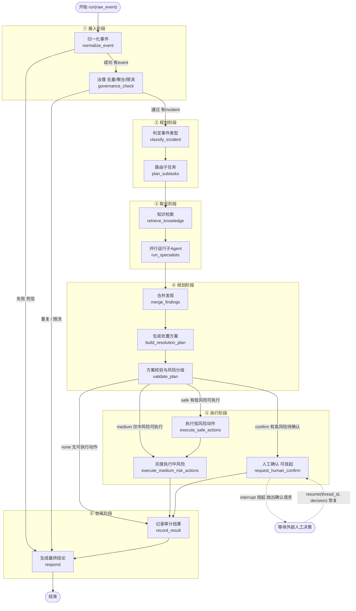
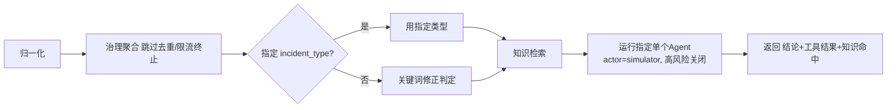

# orchestrator.py 执行流程图

> 对应源文件：`src/industrial_agent/graph/orchestrator.py` 本文件描绘 `IndustrialAgentGraph` 主图的代码执行流程，由 `_build()` 方法构建。

---

## 一、主图执行流程图（14 节点）

---

## 二、分阶段执行解读

这张图由 `_build()` 方法构建，共 **14 个节点**，按 6 个阶段串成一条主干，其中有 **3 处条件路由**会产生分支。

### 阶段① 接入（两道前置闸门）

-   **`normalize_event`（节点 1）**：把 WMS/MES/EAM 等异构报文归一化成 `StandardEvent`。失败 → 写死信审计，路由 `_route_after_normalize` 直接跳到 `respond` 结束，**脏数据不允许流入下游**。
-   **`governance_check`（节点 2）**：去重（同 `idempotency_key` 窗口内丢弃计数）→ 聚合 → 限流（全局并发/单实体上限）。重复或限流 → 路由 `_route_after_governance` 跳到 `respond`；通过则构建 `Incident` 进入下一环。

### 阶段② 规划（派单前准备）

-   **`classify_incident`（节点 3）**：治理层已有初判，再扫描 `KEYWORD_TYPE_MAP` 关键词修正——命中不同类升级为 `mixed_exception`，命中同类归回该类；同时把 Incident 生命周期推进到 `processing`。
-   **`plan_subtasks`（节点 4）**：查 `resolve_codes(incident_type, release_scope)` 得到要跑的 agent 编号列表，生成 `subtasks`（状态统一 `pending`），**受灰度发布范围裁剪**。

### 阶段③ 取证（先知识后取证）

-   **`retrieve_knowledge`（节点 5）**：先反查 `device_type`，再按 incident_type 限定知识库 + 必需元数据维度检索 top_k=5，命中片段写回 state 供子智能体复用。
-   **`run_specialists`（节点 6）**：`ThreadPoolExecutor`（最多 4 worker）并发跑每个子智能体。安全要点：高风险工具一律关闭、写权限受灰度控制、A1/B1 等只读 agent 即便灰度放开也禁写；**单个 agent 抛异常只进 errors，不中断整体**。

### 阶段④ 规划（信息汇聚 → 方案 → 校验）

-   **`merge_findings`（节点 7）**：多 agent 证据去重、数据缺口汇总、置信度 < 0.4 的标记为冲突。
-   **`build_resolution_plan`（节点 8）**：`PlanBuilder` 汇总生成 `ResolutionPlan`，每个动作打 `risk_level` + `requires_human_confirm`。
-   **`validate_plan`（节点 9）**：`PlanValidator` 独立校验可执行性/置信度/风险一致性——这是**方案层的独立闸**，发现的问题写 `validation_issues`。

### 阶段⑤ 执行（按风险三分桶，三条路径）

`_route_by_risk` 按优先级 `confirm > safe > medium > none` 选路径：

-   **`confirm`**（有高风险待确认）→ `request_human_confirm`：通过 `interrupt()` **挂起图**，把确认请求抛给外部，等 `resume(thread_id, decision)` 恢复。
-   **`safe`**（有低风险可执行）→ `execute_safe_actions`：自动执行 `auto` 桶动作，执行完**串接**到中风险节点。
-   **`medium`**（仅中风险可执行）→ `execute_medium_risk_actions`：内部由 `allow_medium_auto` 灰度决定真执行还是转 `deferred` 待办。
-   **`none`**（无可执行动作）→ 跳过执行，直接 `record_result`。

> 注意 `execute_safe_actions → execute_medium_risk_actions` 这条**固定连线**：即使走 safe 路由，低风险跑完也会进中风险节点，由灰度判断中风险是否真执行，保证两条路径在中风险处汇合。

### 阶段⑥ 收尾

-   **`record_result`（节点 11）**：汇总方案执行概况落审计；无需确认的事件在此闭环（`closed`），仍等确认的保持 `waiting_confirm`。
-   **`respond`（节点 12）**：拼装人类可读的 `final_answer`（问题概述/置信度/数据缺口/动作清单/确认与校验状态）。

---

## 三、两个关键机制

### 1. 挂起 / 恢复（人工确认闭环）

图右上角的虚线环展示了 `request_human_confirm` 的交互：

-   节点内调用 `interrupt(payload)` → 图暂停、payload 返回前端；
-   外部调 `resume(thread_id, {"approved": ...})` → 从 `interrupt` 返回处继续；
-   `thread_id`（默认取事件 `trace_id`）是连接挂起与恢复的纽带，由 `InMemorySaver` 检查点保存中间状态。

### 2. 安全默认（贯穿全图）

-   `decision` 非 dict 或 `approved` 缺省 → 一律视为**未批准**（严禁默认同意）；
-   即便人工同意，若灰度未开放 `allow_high_confirm`，也只转人工待办，不自动执行；
-   `record_result` 不会把等确认的事件误标为 `closed`。

---

## 四、旁路：单 Agent 模拟

`run_single_agent` **不进主图**，是一条独立的轻量旁路，供前端逐个观察单个智能体：

它复用主图节点 1/2/3/5 的逻辑，保证单 Agent 行为与真实编排一致，但 `actor` 标记为 `simulator` 以便审计溯源区分。

---

## 五、节点与状态字段速查表

| 节点 | 方法 | 功能说明 | 写入的 state 字段 | 阶段 |
|:---:|------|----------|-------------------|:---:|
| 1 | `_normalize_event` | 把外部原始异构报文（WMS/MES/EAM 等）归一化成统一 `StandardEvent`；失败则写死信审计，路由直接跳到 `respond` 结束，脏数据不流入下游 | `event` / `errors` / `final_answer` | 接入 |
| 2 | `_governance_check` | 事件治理：窗口内去重、按实体聚合、全局并发与单实体限流；通过后构建 `Incident`，重复或被限流则提前终止流程 | `incident` / `duplicate` / `throttled` / `final_answer` | 接入 |
| 3 | `_classify_incident` | 判定事件类型 `incident_type`：在治理初判基础上用关键词命中修正（跨类命中升级为 `mixed_exception`），并把 Incident 生命周期推进到 `processing` | `incident` / `incident_type` | 规划 |
| 4 | `_plan_subtasks` | 路由子任务：按 `incident_type` + 灰度发布范围查 `resolve_codes`，确定要跑的子智能体编号列表，生成统一 `pending` 状态的 `subtasks` | `subtasks` / `agent_codes` | 规划 |
| 5 | `_retrieve_knowledge` | 知识检索：先反查 `device_type`，再按 `incident_type` 限定知识库与必需元数据维度，检索 `top_k=5` 命中片段写回 state 供子智能体复用（先知识后取证） | `knowledge_refs` | 取证 |
| 6 | `_run_specialists` | 并行运行子智能体：线程池并发（≤4 worker）跑各 agent；高风险工具一律关闭、写权限随灰度、只读 agent 禁写；单个 agent 异常只进 `errors` 不中断整体 | `agent_findings` / `errors` | 取证 |
| 7 | `_merge_findings` | 合并多智能体发现：证据去重、汇总数据缺口、标记置信度 < 0.4 的冲突，输出统一的 `merged_findings` 供方案生成参考 | `merged_findings` | 规划 |
| 8 | `_build_plan` | 生成处置方案：综合事件、各 agent 结论、知识命中、数据质量与冲突，由 `PlanBuilder` 生成 `ResolutionPlan`，并算出方案中动作的最高风险等级 | `resolution_plan` / `risk_level` | 规划 |
| 9 | `_validate_plan` | 方案校验与风险分级：`PlanValidator` 独立校验可执行性 / 置信度 / 风险一致性，问题写入 `validation_issues`，并透传 `need_human_confirm` 给路由 | `resolution_plan` / `validation_issues` / `need_human_confirm` | 规划 |
| 10a | `_execute_safe_actions` | 执行低风险动作：执行 `plan_dispatch` 分出的 `auto` 桶动作，无需人工确认，自动调用工具执行（执行器内部带九步检查 + 失败回滚 + 审计） | `executed_actions` | 执行 |
| 10b | `_execute_medium_risk_actions` | 灰度执行中风险：累积已执行动作，按 `allow_medium_auto` 灰度决定真执行 `todo` 桶动作，还是转为 `deferred` 人工待办 | `executed_actions` / `deferred_actions` | 执行 |
| 10c | `_request_human_confirm` | 人工确认（可挂起）：对 `confirm` 桶高风险动作生成确认请求，`interrupt()` 挂起等待外部 `resume`；批准且灰度允许才执行，否则转人工待办 | `confirm_request` / `confirm_status` / `executed_actions` / `deferred_actions` | 执行 |
| 11 | `_record_result` | 记录审计结果：汇总方案执行概况落审计；无需确认的事件闭环为 `closed`，仍等确认的保持 `waiting_confirm` | `audit_log_id` | 收尾 |
| 12 | `_respond` | 生成最终结论：拼装人类可读的 `final_answer`（问题概述 / 置信度 / 数据缺口 / 动作清单 / 确认与校验状态）；提前终止的流程则透传既有结论 | `final_answer` | 收尾 |