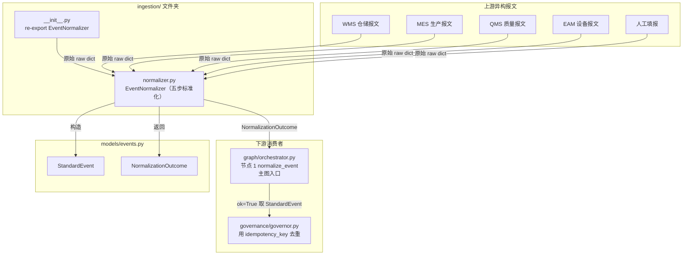

# ingestion 模块说明

本文件夹是**事件接入与标准化层**（主图节点 1 的实现）：把上游 WMS / MES / QMS / EAM / 人工填报等异构原始报文，转换为系统内部统一的 `StandardEvent`。它是整个流水线的"入口海关"——所有外部数据必须先在这里过一遍字段校验、时间统一、标识生成、质量标记，合格才能流入下游治理/分类/取证。

> 设计原则：**脏数据绝不流入下游**。任何字段缺失、时间非法、来源不明的报文，要么被自动修正降级，要么直接进死信队列（`ok=False`），让主图路由提前跳到 `respond` 结束，绝不带病流转。

## 一、设计要点

1. **五步标准化流水线**（`normalize` 内部顺序）：
   1. **报文非空校验**：空报文或非 JSON 对象 → 死信 `EMPTY_PAYLOAD`；
   2. **关键字段校验**：`event_type` 缺失 → 死信 `MISSING_EVENT_TYPE`（无法路由）；`source_system` 非法/不在白名单 → 死信 `INVALID_SOURCE_SYSTEM`；
   3. **时间统一**：`occurred_at` 解析为带时区的 UTC；缺失/未来时间/偏移过大 → 降级用接收时间 `received_at`；无时区 → 按 UTC 处理；
   4. **标识生成**：`trace_id`（全链路追踪，缺省生成 `trace-`+12hex）、`idempotency_key`（去重键，缺省按 `源系统:事件类型:锚点实体:报警码` 拼）、`event_id`（缺省 `evt-`+16hex）；
   5. **质量标记**：`data_quality` 三档——`complete`（关键字段齐 + 时间无问题）/ `partial`（缺关键字段但时间正常）/ `suspicious`（时间有问题，最高警示级）。下游规划会据此调整置信度。

2. **双来源字段提取**：每个字段优先从报文顶层 `raw` 取，取不到再从 `payload` 子对象取（兼容"扁平报文"和"payload 嵌套报文"两种上游格式）。实体字段（device/wo/batch 等）统一收集进 `entities` 字典，既用于构造 `StandardEvent`，也用于生成去重键。

3. **容错降级而非直接拒绝**（对非关键字段）：`severity` 非法 → 降级 `medium`；`occurred_at` 无法解析 → 用接收时间并标记时间问题。只有真正阻断路由的字段（event_type / source_system / 时间完全无法解析）才进死信。

4. **去重键生成的稳定性（`_build_idempotency_key`）**：缺省键按"源系统 → 事件类型 → 锚点实体（wo > batch > device > material > unknown）→ 报警码"拼接，保证同一物理故障的重复上报产生相同 key，治理层（`governance.is_duplicate`）据此去重。锚点优先级体现"工单/批次比设备更能标识一次业务事件"。

5. **原始报文全量留存**：`StandardEvent` 同时保留 `payload`（业务载荷）和 `raw_payload`（完整原始报文），便于事后排查与重放——归一化不会丢失任何原始信息。

## 二、文件清单与作用

| 文件 | 作用 | 类比 |
|------|------|------|
| [`__init__.py`](./__init__.py) | 包入口：re-export `EventNormalizer`，让外部直接 `from industrial_agent.ingestion import EventNormalizer` | 接待台名片 |
| [`normalizer.py`](./normalizer.py) | **接入层主体**：`EventNormalizer` 类——异构报文 → 统一 `StandardEvent`，含字段校验/时间统一/标识生成/质量标记/去重键生成，以及 6 个常量（白名单/字段清单/时间偏移阈值） | 入口海关的报关与检疫台 |

> 本模块**只负责"标准化逻辑"**，数据结构定义在别处：
> - `StandardEvent`（标准化后的标准事件）定义在 [`models/events.py`](../models/events.py)；
> - `NormalizationOutcome`（标准化结果：成功事件或死信原因）也定义在 `models/events.py`。

## 三、文件之间的协作关系



一次报文的标准化全流程（主图节点 1 内部）：

```
上游原始报文 raw（dict）进入 EventNormalizer.normalize(raw)
   │
   ▼ ① 非空校验
   ├─ 空/非 dict → NormalizationOutcome(ok=False, error_code="EMPTY_PAYLOAD")，主图跳 respond
   └─ 通过 → 继续
   │
   ▼ ② event_type + source_system 校验（白名单 SOURCE_SYSTEMS）
   ├─ 缺 event_type → 死信 MISSING_EVENT_TYPE
   ├─ source_system 非法 → 死信 INVALID_SOURCE_SYSTEM
   └─ 通过 → 继续
   │
   ▼ ③ 时间统一 _parse_time
   解析 occurred_at（ISO8601，兼容 "Z"）；无时区按 UTC；
   未来时间(>now+5min) / 偏移过大(>7天前) → 降级用 received_at，标记时间问题；
   完全无法解析 → 死信 INVALID_TIMESTAMP
   │
   ▼ ④ 标识生成
   trace_id（缺省 trace-xxx）/ idempotency_key（缺省 源:类型:锚点:报警码）/ event_id（缺省 evt-xxx）
   │
   ▼ ⑤ 质量标记 + 实体提取
   检查 CRITICAL_FIELDS 缺失情况，结合时间问题 → data_quality: complete/partial/suspicious
   从 raw + payload 双来源提取 ENTITY_FIELDS（factory/line/wo/material/batch/device/alarm）
   │
   ▼ 构造 StandardEvent（含 raw_payload 全量留存）
   NormalizationOutcome(ok=True, event=event) → 主图取 event 进入节点 2 治理
```

## 四、关键公共概念

- **模块级常量**：
  | 常量 | 作用 |
  |------|------|
  | `SOURCE_SYSTEMS` | 来源系统白名单（WMS/MES/QMS/EAM/MANUAL），不在此列 → 死信 |
  | `SEVERITIES` | 严重度合法值集合（low/medium/high/critical），非法 → 降级 medium |
  | `CRITICAL_FIELDS` | 关键字段清单（event_type/source_system/occurred_at/severity/tenant_id），缺失影响 data_quality |
  | `ENTITY_FIELDS` | 实体字段清单（factory/line/wo/material/batch/device/alarm），用于构造事件 + 生成去重键 |
  | `MAX_FUTURE_SKEW` | 未来时间容忍阈值（5 分钟），超过 → 降级用接收时间 |
  | `MAX_HISTORY_SKEW` | 历史时间偏移阈值（7 天），超过 → 降级用接收时间 |

- **`NormalizationOutcome`（返回结果）**：
  - `ok=True` → `event` 是标准化后的 `StandardEvent`，`dead_letter_reason`/`error_code` 为 None；
  - `ok=False` → `event` 为 None，`dead_letter_reason` 是人类可读原因，`error_code` 是机器可读错误码（主图写进 errors，路由跳 respond）。

- **4 种死信错误码**：
  | error_code | 触发条件 |
  |------------|----------|
  | `EMPTY_PAYLOAD` | 报文为空或非 JSON 对象 |
  | `MISSING_EVENT_TYPE` | 缺 event_type（无法路由） |
  | `INVALID_SOURCE_SYSTEM` | source_system 缺失或不在白名单 |
  | `INVALID_TIMESTAMP` | occurred_at 完全无法解析为时间 |

- **`data_quality` 三档判定逻辑**：
  ```
  无缺关键字段 且 无时间问题 → complete
  缺关键字段 但 时间正常    → partial
  有时间问题（无时区/未来/偏移过大）→ suspicious（无论是否缺字段，时间问题优先级最高）
  ```
  `suspicious` 是最高警示级，下游规划层会据此降低方案置信度。

- **`idempotency_key` 缺省生成规则**（`_build_idempotency_key`）：
  `"{source_system}:{event_type}:{anchor}:{alarm_code}"`，锚点取 `work_order_id > batch_id > device_id > material_id > "unknown"`。同一物理故障的重复上报产生相同 key，治理层据此去重。

- **`EventNormalizer(tenant_id="factory_a")`**：构造器只存一个默认租户 ID（当报文未带 tenant_id 时使用），无状态、线程安全，可被主图复用。

## 五、扩展指南

- **新增来源系统**：在 `SOURCE_SYSTEMS` 加新值（如 `SCADA`、`LIMS`），并在 `models/events.py` 的 `SourceSystem` 枚举/`INCIDENT_TYPE_BY_EVENT_PREFIX` 加对应路由前缀，否则该来源的事件无法被分类路由。
- **新增实体字段**：在 `ENTITY_FIELDS` 加字段名，在 `StandardEvent` 模型加对应字段，在 `normalize` 的 `StandardEvent(...)` 构造处赋值，并考虑是否纳入 `_build_idempotency_key` 的锚点优先级。
- **放宽/收紧时间阈值**：调整 `MAX_FUTURE_SKEW` / `MAX_HISTORY_SKEW`。工业现场设备时钟可能漂移，若误报率高可适当放宽；若对时序精度要求高可收紧。
- **新增死信校验**：若需对 `event_type` 格式、`message` 长度等做更严格校验，在 `normalize` 的对应位置加 `return NormalizationOutcome(ok=False, ...)` 分支，并在错误码表中登记。
- **接入真实消息队列**：当前 `normalize` 接收 dict 是被主图/API 直接调用。若上游是 Kafka/RabbitMQ，可在消费端把消息体转 dict 后调 `normalize`，把死信 `error_code` 写入死信队列（DLQ）。
- **可观测性埋点**：`normalize` 目前不直接写审计（由主图节点 1 根据 outcome 写 `event:normalized` 或 `event:dead_letter`）。若需接入层独立埋点，可注入 `AuditRecorder` 并在成功/失败分支各落一条。