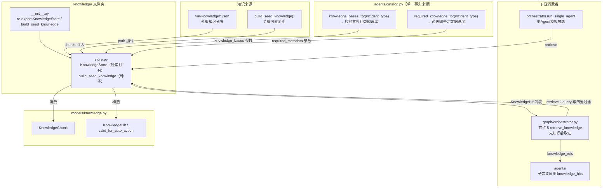

# knowledge 模块说明

本文件夹是**知识底座与检索层**（主图节点 5 的实现）：为下游智能体提供"先知识后取证"的相关知识片段。它把知识分块（`KnowledgeChunk`）从 JSON 加载进内存，按事件携带的实体维度（设备类型/报警码/工序/产品码）+ 关键词命中做加权打分检索，并校验必需元数据维度——**元数据缺失的知识只允许参考，不允许支撑自动动作**，这是工业场景"知识可信才能自动执行"的安全底线。

## 一、设计要点

1. **四维元数据匹配 + 关键词重叠打分**（`retrieve` 评分模型）：
   | 匹配项 | 加权分 | 说明 |
   |--------|--------|------|
   | 报警代码命中 | +6.0 | 最强信号：同报警码的 SOP 最相关 |
   | 设备类型匹配 | +4.0 | 设备类知识的适用性锚点 |
   | 工序匹配 | +2.0 | 工艺上下文相关性 |
   | 产品码匹配 | +2.0 | 产品专属知识 |
   | 关键词重叠 | +0.75/个（封顶 8 个） | query 与 chunk 标题/路径/正文的词交集 |
   | 文档已过期 | -2.0 | 降权但不丢弃（仍可参考） |
   | 高风险文档 | +0.5 | 权威级文档（如高风险 SOP）小幅加权 |

   `score <= 0` 的 chunk 不进入结果；最终按 score 降序取 `top_k`（默认 5），且只保留 `score > 0`。

2. **按子图限定知识库归属**（`knowledge_bases` 过滤）：catalog 按 `incident_type` 决定本事件该检索哪几类知识库（四类：`process` 工艺 / `quality` 质量 / `equipment` 设备 / `trace` 追溯）。不在范围内的 chunk 直接跳过，避免无关知识干扰。

3. **必需元数据校验（`required_metadata` → `missing_filters`）**：catalog 还会指定本事件"必需哪些元数据维度"（如设备异常要求 `device_type` + `alarm_code`）。命中的 chunk 若缺这些维度，不丢弃但写入 `missing_filters`，由 `KnowledgeHit.valid_for_auto_action` 判定为 `False`——**此类知识只允许作为参考，不允许支撑自动动作**（下游规划/执行据此控制写动作）。

4. **过期降权而非丢弃**（`_is_expired`）：`expire_date` 早于 today 的文档扣 2 分并标记 `expired=True`，仍出现在结果里供参考，但 `valid_for_auto_action` 会因 `expired` 为 False——过期知识同样不能支撑自动动作。

5. **知识加载：显式注入 + JSON 目录/文件**：`KnowledgeStore(chunks, path)` 接收显式分块和/或路径；`path` 为目录时递归加载所有 `*.json`，为文件时加载单个。目录结构支持每个 JSON 是 `[{...}, ...]` 列表或 `{"chunks": [...]}` 包裹。`build_seed_knowledge()` 提供 7 条内置示例分块（覆盖四类知识库），供无外部知识库时注入跑通链路。

6. **原始文本全量检索**：分词用 `[\w\u4e00-\u9fff]+`（支持中英文），取小写、长度 > 1 的 token 做交集，不依赖外部向量模型——零依赖、确定性、可审计。

## 二、文件清单与作用

| 文件 | 作用 | 类比 |
|------|------|------|
| [`__init__.py`](./__init__.py) | 包入口：re-export `KnowledgeStore` 与 `build_seed_knowledge`，让外部直接 `from industrial_agent.knowledge import ...` | 接待台名片 |
| [`store.py`](./store.py) | **知识底座主体**：`KnowledgeStore` 类（加载/检索/打分/元数据校验/过期判定）+ `build_seed_knowledge()`（7 条内置种子分块）+ 评分常量与分词工具 | 图书馆的检索目录台 |

> 本模块**只负责"知识加载与检索逻辑"**，数据结构定义在别处：
> - `KnowledgeChunk`（知识分块）/ `KnowledgeHit`（检索命中，含 `valid_for_auto_action`）/ `KnowledgeBase`（四类知识库字面量）定义在 [`models/knowledge.py`](../models/knowledge.py)。

## 三、文件之间的协作关系



一次知识检索的全流程（主图节点 5 内部）：

```
主图节点 5 retrieve_knowledge 拿到 Incident（含 entity_refs）
   │
   ▼ 反查 device_type（通过 query_device_status 工具，失败则 None）
   │
   ▼ 拼装 query：优先 alarm_code + material_id + batch_id，退化为 incident_type
   │
   ▼ 从 catalog 取本 incident_type 的：
   ├─ knowledge_bases_for → 限定检索哪些知识库（如设备异常 → equipment）
   └─ required_knowledge_for → 必需元数据维度（如 device_type + alarm_code）
   │
   ▼ KnowledgeStore.retrieve(query, device_type, alarm_code, process, product_code,
                              knowledge_bases, required_metadata, top_k=5)
   │
   ▼ 遍历所有 chunk：
   1. 知识库过滤：chunk.knowledge_base 不在 bases → 跳过
   2. 打分：报警码+6 / 设备+4 / 工序+2 / 产品+2 / 关键词重叠+0.75×N
   3. score<=0 → 跳过（无任何匹配）
   4. 过期判定 → -2 并标 expired
   5. 高风险文档 → +0.5
   6. 必需元数据校验 → missing_filters（缺则标，不丢弃）
   7. 生成 KnowledgeHit（含 reasons 说明每条命中的理由）
   │
   ▼ 按 score 降序取 top_k，过滤 score>0
   │
   ▼ 返回 list[KnowledgeHit] → 主图序列化进 state.knowledge_refs → 传给子智能体
   下游规划看每个 hit 的 valid_for_auto_action（!expired && !missing_filters）
   决定哪些知识能支撑自动动作，哪些只能参考
```

## 四、关键公共概念

- **`KnowledgeStore(chunks=None, *, path=None)`**：构造器。`chunks` 是显式传入的分块列表；`path` 是 JSON 文件或目录（目录递归加载 `*.json`）。两者可叠加（先 chunks，再 extend path 加载的）。不传任何参数则为空库——调用方需自行注入 `build_seed_knowledge()` 或指向知识目录。

- **`_load_json(path)`**：加载逻辑。目录 → 排序后逐个 glob `*.json` 递归；文件 → 读 JSON，兼容 `[...]` 列表与 `{"chunks": [...]}` 两种格式，每行用 `KnowledgeChunk.model_validate` 校验（Pydantic 保证分块结构合法）。

- **`retrieve(...)` 评分与过滤参数**：
  - `query`：检索文本（报警码/物料/批次或 incident_type）；
  - `device_type` / `alarm_code` / `process` / `product_code`：四维实体过滤（命中加分，不命中不扣分）；
  - `knowledge_bases`：知识库白名单（catalog 按 incident_type 限定）；
  - `required_metadata`：必需元数据维度（`process`/`version`/`alarm_code`/`device_type`/`product_code`），缺失进 `missing_filters`；
  - `top_k`：返回条数上限（默认 5）；
  - `today`：过期判定基准（缺省取当天，便于测试注入固定日期）。

- **`KnowledgeHit`（检索命中）字段**：
  - `chunk`：命中的知识分块；
  - `score`：加权打分（保留 2 位小数）；
  - `expired`：是否过期；
  - `reasons`：命中理由列表（如 `["报警代码命中", "关键词命中 3 个"]`），前端展示"为什么命中"，也用于审计可解释；
  - `missing_filters`：缺失的必需元数据维度；
  - `valid_for_auto_action`（只读属性）：`not expired and not missing_filters`——**这是"知识能否支撑自动动作"的判定闸门**。

- **`build_seed_knowledge()`**：返回 7 条内置 `KnowledgeChunk`，覆盖四类知识库（equipment×3 / quality×1 / trace×2 / process×1），含报警码、设备类型、工序、产品码、过期日期（第 5 条 expire=2025-12-31 用于演示过期降权）、风险等级（2 条 high 用于演示权威加权）。供无外部知识库时跑通全链路与测试。

- **分词规则（`_tokens`）**：正则 `[\w\u4e00-\u9fff]+` 匹配中英文词，小写化、过滤长度 ≤ 1 的 token。query 与 chunk 的 `title + section_path + text` 分词后求交集。

## 五、扩展指南

- **接入外部知识库**：把知识管理系统导出为 `var/knowledge/*.json`（格式为 `[{chunk字段...}, ...]` 或 `{"chunks": [...]}`），启动时 `KnowledgeStore(path=settings.knowledge_path)` 即可。字段需符合 `KnowledgeChunk` 模型。
- **替换为向量检索**：当前是关键词/元数据加权打分（零依赖、确定性）。若需语义检索，可新增 `VectorKnowledgeStore` 继承并重写 `retrieve`，用嵌入模型算相似度；保持 `knowledge_bases` / `required_metadata` / `valid_for_auto_action` 契约不变，主图无需改动。
- **增量更新知识**：当前 `add(chunk)` 只追加不更新。若需按 `chunk_id` 去重更新，可在 `add` 里先按 `chunk_id` 删除旧分块再追加；或新增 `reload(path)` 重新加载。
- **元数据维度扩展**：在 `models/knowledge.py` 的 `KnowledgeChunk` 加字段，在 `store.py` 的 `METADATA_FIELDS` / `_missing_filters` / `retrieve` 评分里加对应分支，在 catalog 的 `SUBGRAPH_REQUIRED_KNOWLEDGE` 加维度。注意保持"缺失进 missing_filters 而非丢弃"的安全语义。
- **过期策略增强**：当前只看 `expire_date < today`。若需"即将过期提醒"或"版本有效性校验"，可在 `_is_expired` 外新增 `_near_expiry` 并在 reasons 里标记，或在 `required_metadata` 中把 `version` 缺失视为 missing。
- **可观测性**：`retrieve` 当前不写审计（由主图节点 5 写 `knowledge:retrieve`）。若需知识层独立埋点（如命中分布、过期命中率），可注入 `AuditRecorder` 并在返回前落一条统计记录。