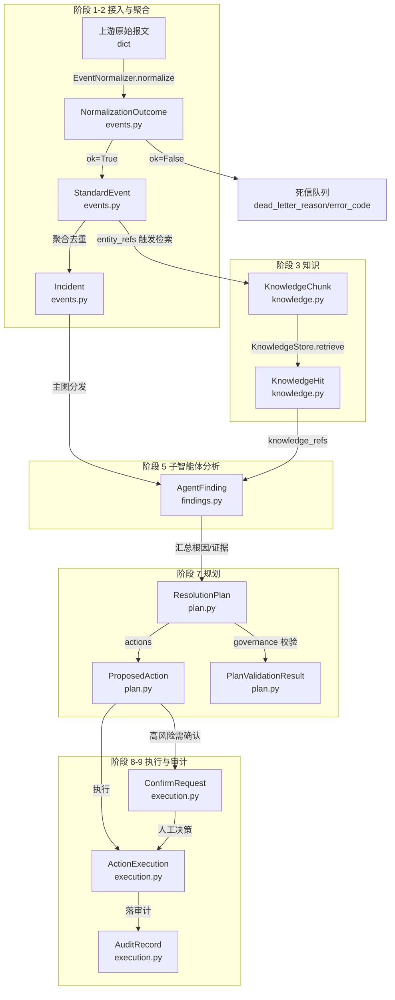

# models 模块说明

本文件夹是**全系统的数据模型层（DTO / 领域对象）**：用 Pydantic `BaseModel` 定义贯穿整条工业智能体流水线的"标准数据契约"。从事件接入（标准化事件）→ 聚合（问题实例）→ 知识检索（知识分块/命中）→ 子智能体分析（发现）→ 规划（解决方案/动作）→ 执行（人工确认/执行结果）→ 审计（审计记录），每一步的输入输出都由这里的模型承载。

模型层**只定义结构，不含业务逻辑**（业务逻辑在 ingestion/agents/graph/governance/execution 等层）。所有模型用 Pydantic 自动校验类型与取值范围，是"脏数据绝不流入下游"的第一道结构屏障。

## 一、设计要点

1. **Pydantic 单一事实来源**：所有跨层传递的对象都是这里定义的 `BaseModel` 子类，序列化/反序列化、类型校验、默认值集中管理，避免各层各写一套 dict 导致字段漂移。

2. **字面量枚举（`Literal`）锁住合法值域**：`SourceSystem`、`Severity`、`DataQuality`、`IncidentType`、`IncidentStatus`、`ConfirmStatus`、`ExecutionStatus`、`AuditDecision`、`ActionType`、`RiskLevel` 等全部用 `Literal[...]` 约束，Pydantic 在构造时自动拒绝非法值——把"非法枚举"挡在模型边界，而非运行到下游才报错。

3. **流水线分段对齐**：模型按流水线阶段切分到 5 个文件，每个文件顶部 docstring 标注所属阶段编号（如"阶段 1.4"、"阶段 7.2"），与主图节点一一对应：
   - `events.py` → 阶段 1（接入标准化）+ 阶段 2（聚合）
   - `knowledge.py` → 阶段 3（知识）
   - `findings.py` → 阶段 5（子智能体分析）
   - `plan.py` → 阶段 7（规划与校验）
   - `execution.py` → 阶段 8/9（执行与审计）

4. **原始数据全量留存**：`StandardEvent` 同时保留 `payload`（标准化提取的结构化字段）与 `raw_payload`（上游原始报文），便于排查与重放，不丢失任何上游信息。

5. **安全相关字段显式建模**：`requires_human_confirm`、`valid_for_auto_action`（在 `KnowledgeHit`）、`rollback_hint`、`risk_level` 等字段直接嵌入模型，让"哪些动作能自动执行"成为数据本身的属性，下游决策无需再推断。

## 二、文件清单与作用

| 文件 | 作用 | 关键导出 |
|------|------|----------|
| [`__init__.py`](./__init__.py) | 包入口：re-export 全部公共模型，让外部 `from industrial_agent.models import Incident, ...` 直接使用 | `__all__` 清单 |
| [`events.py`](./events.py) | **事件与问题实例模型**：标准化后的事件、聚合后的问题实例、标准化结果（含死信原因） | `StandardEvent` / `Incident` / `NormalizationOutcome` / `SourceSystem` / `Severity` / `DataQuality` / `IncidentType` / `IncidentStatus` |
| [`knowledge.py`](./knowledge.py) | **知识模型**：知识分块、检索命中（含能否自动动作判定） | `KnowledgeChunk` / `KnowledgeHit` / `KnowledgeBase` / `RiskLevel` |
| [`findings.py`](./findings.py) | **子智能体统一输出**：13 类子智能体共用的发现结构 | `AgentFinding` |
| [`plan.py`](./plan.py) | **规划模型**：解决方案、动作项、规划校验结果 | `ResolutionPlan` / `ProposedAction` / `PlanValidationResult` / `PlanValidationIssue` / `ActionType` |
| [`execution.py`](./execution.py) | **执行与审计模型**：人工确认请求、执行结果、审计记录 | `ConfirmRequest` / `ActionExecution` / `AuditRecord` / `ConfirmStatus` / `ExecutionStatus` / `AuditDecision` |

> `RiskLevel` 在 `knowledge.py` 和 `plan.py` 中均有定义（各自模块内使用），`__init__.py` 从 `plan.py` 导出包级 `RiskLevel`。

## 三、数据在流水线中的流转（模型视角）

## 四、各模型详解

### 4.1 events.py — 事件与问题实例

| 模型/类型 | 说明 |
|-----------|------|
| `SourceSystem` | 来源系统白名单：`WMS`/`MES`/`QMS`/`EAM`/`MANUAL`（ingestion 校验，非法进死信） |
| `Severity` | 严重度：`low`/`medium`/`high`/`critical` |
| `DataQuality` | 数据质量三档：`complete`（无问题）/`partial`（缺关键字段）/`suspicious`（时间问题，优先级最高） |
| `StandardEvent` | **标准化事件**：接入层产出的统一结构。含事件标识（`event_id`/`trace_id`/`idempotency_key`）、来源与时间、严重度、实体引用（工单/物料/批次/设备/报警码）、`payload`（提取的结构化字段）+ `raw_payload`（原始报文全量留存）、`data_quality` 质量标记、`schema_version` |
| `IncidentType` | 问题类型：`production_exception`/`material_exception`/`quality_exception`/`equipment_exception`/`mixed_exception`/`query`/`standalone`（catalog 据此决定子图/知识库/智能体路由） |
| `IncidentStatus` | 问题生命周期：`new`/`processing`/`waiting_confirm`/`closed`/`failed` |
| `Incident` | **聚合后的问题实例**：把同源同实体的多条事件聚合为一个问题。含 `incident_id`/`trace_id`、关联的 `event_ids` 与 `event_count`、类型与严重度、`priority_score`（优先级评分）、首次/末次发生时间、`entity_refs`（实体字典，驱动检索与工具调用）、状态 |
| `NormalizationOutcome` | **标准化结果**：`ok=True` 时携带 `event`；`ok=False` 时携带 `dead_letter_reason` + `error_code`（4 种死信错误码：`EMPTY_PAYLOAD`/`MISSING_EVENT_TYPE`/`INVALID_SOURCE_SYSTEM`/`INVALID_TIMESTAMP`） |

### 4.2 knowledge.py — 知识

| 模型/类型 | 说明 |
|-----------|------|
| `KnowledgeBase` | 四类知识库：`process`（工艺）/`quality`（质量）/`equipment`（设备）/`trace`（追溯） |
| `RiskLevel` | 知识风险等级：`low`/`medium`/`high`（高风险文档权威加权 +0.5） |
| `KnowledgeChunk` | **知识分块**：知识管理系统导入的最小检索单元。含 `chunk_id`/`doc_id`/`title`/`section_path`/`version`/`effective_date`/`expire_date`、`knowledge_base` 归属、四维适用元数据（`applicable_device_types`/`applicable_alarm_codes`/`applicable_process`/`applicable_product_codes`）、`risk_level`/`owner`/`text`/`source_uri` |
| `KnowledgeHit` | **检索命中**：`KnowledgeStore.retrieve` 的返回项。含 `chunk`/`score`/`expired`/`reasons`（命中理由，可解释）/`missing_filters`（缺失的必需元数据）；只读属性 `valid_for_auto_action = not expired and not missing_filters`——**知识能否支撑自动动作的判定闸门** |

### 4.3 findings.py — 子智能体输出

| 模型 | 说明 |
|------|------|
| `AgentFinding` | **13 类子智能体统一输出结构**。含 `agent_name`（智能体标识）、`summary`（摘要）、`findings`（发现列表）、`hypotheses`（根因假设）、`evidence`（证据，list[dict]）、`knowledge_refs`（引用的知识分块 id）、`confidence`（0-1 置信度）、`data_gaps`（数据缺口，治理层据此降级/阻断）、`suggested_next_steps`（建议下一步）、`risk_notes`（风险提示） |

### 4.4 plan.py — 规划

| 模型/类型 | 说明 |
|-----------|------|
| `RiskLevel` | 动作风险等级：`low`/`medium`/`high` |
| `ActionType` | 动作类型六档：`query_only`（仅查询）/`notify_user`（通知用户）/`create_ticket_draft`（创建工单草稿）/`execute_safe_function`（执行安全函数）/`request_human_confirm`（请求人工确认）/`control_suggestion`（控制建议） |
| `ProposedAction` | **方案中的单个动作**：`action_id`/`action_type`/`title`/`description`、`risk_level`、`requires_human_confirm`（是否需人工确认）、`executable`（是否可执行）、`tool_name`/`tool_args`（执行工具与参数）、`preconditions`（前置条件）、`rollback_hint`（回滚提示）、`evidence_refs`（证据引用） |
| `ResolutionPlan` | **解决方案**：`plan_id`/`incident_id`/`problem_summary`、`root_cause_hypotheses`（根因假设）、`evidence`/`knowledge_references`、`actions`（动作列表）、`user_instruction`（用户指令）、`prohibitions`（禁止项，治理红线）、`data_gaps`、`need_human_confirm`、`confidence`、`validity_note`（治理校验备注） |
| `PlanValidationIssue` | 规划校验发现的单个问题：`code`/`message`/`action_id` |
| `PlanValidationResult` | **规划校验结果**：`ok`（是否通过）/`issues`（问题列表）/`risk_escalated`（是否升级了风险）/`confidence_adjusted`（是否调整了置信度） |

### 4.5 execution.py — 执行与审计

| 模型/类型 | 说明 |
|-----------|------|
| `ConfirmStatus` | 人工确认状态：`pending`/`approved`/`rejected`/`expired`/`executed`/`failed` |
| `ExecutionStatus` | 执行结果状态：`success`/`failed`/`partial`/`rolled_back` |
| `AuditDecision` | 审计决策：`allowed`/`denied`/`confirmed`/`rejected`/`executed`/`rolled_back` |
| `ConfirmRequest` | **人工确认请求**：高风险动作执行前生成。含 `confirm_id`/`incident_id`/`plan_id`/`action_id`、`action_title`/`action_detail`、`tool_name`/`tool_args`、`risk_level`/`risks`/`rollback_hint`、`required_roles`（所需审批角色）/`assignee`、`created_at`/`expire_at`（过期时间）、`status`/`decision_by`/`decision_at`/`decision_note` |
| `ActionExecution` | **执行结果记录**：`execution_id`/`incident_id`/`plan_id`/`action_id`、`tool_name`/`tool_args_snapshot`（参数快照）、`started_at`/`finished_at`、`status`/`result_summary`/`error_code`、`rollback_executed`（是否已回滚）、`operator` |
| `AuditRecord` | **审计记录**：全链路每一步决策的留痕。含 `audit_id`/`trace_id`/`incident_id`、`actor`/`roles`、`action`/`target`、`input_snapshot`/`output_snapshot`（输入输出快照）、`risk_level`/`decision`/`reason`、`created_at` |

## 五、扩展指南

- **新增模型**：按流水线阶段归入对应文件（或新建文件），继承 `BaseModel`，在文件顶部 docstring 标注阶段编号，并在 `__init__.py` 的 import 与 `__all__` 中登记，确保外部可统一导入。
- **新增枚举值**：扩展对应 `Literal[...]` 即可，Pydantic 自动校验。注意同步更新使用方的分支逻辑（如新增 `SourceSystem` 要同步 ingestion 白名单、catalog 路由）。
- **字段校验增强**：用 Pydantic 的 `Field(ge=..., le=..., pattern=...)` 或 `@field_validator` 加约束（如 `confidence` 已用 `ge=0, le=1`）。把校验放在模型层，让非法数据在入口就被拒绝。
- **版本演进**：`StandardEvent.schema_version` 预留了版本字段。破坏性变更时升版本号并在 ingestion 做兼容转换，避免下游解析失败。
- **序列化**：所有模型支持 `.model_dump()` 转 dict、`.model_dump_json()` 转 JSON（API 层直接用），`.model_validate()` 反向校验。跨进程传递时用 JSON，同进程直接传对象。