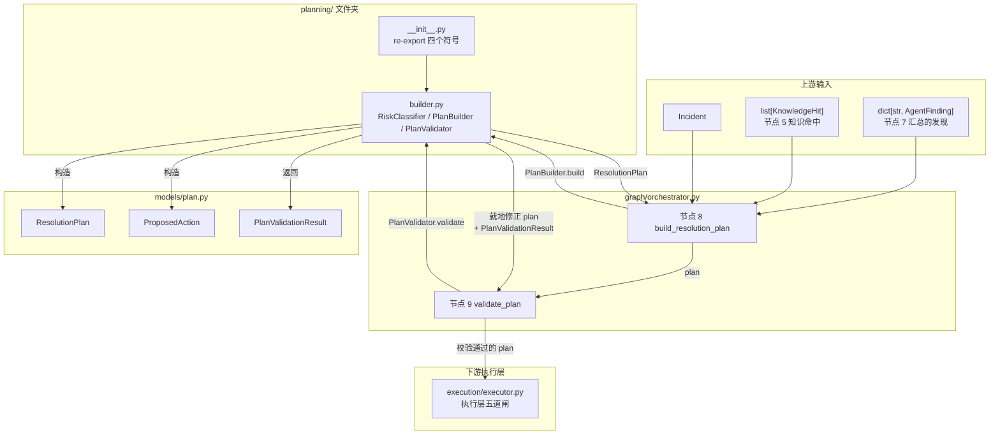

# planning 模块说明

本文件夹是**方案生成与风险分级层**（主图节点 8 / 9 的实现），承接主图节点 7（merge_findings）汇总后的多智能体统一发现，负责把取证结论变成一份**可执行、可审计、可风险分级**的处置方案，并在交给执行层前做最后一道独立校验。

这是系统"三道闸纵深防御"中的**方案层闸**（另两道是工具层 `ToolRegistry` 九步链、执行层 `ActionExecutor` 五道闸）——三层独立校验，一层漏了下一层还能兜住。

## 一、设计要点

1. **规则优先 + 保守降级 + 证据驱动**：LLM 只在取证阶段用，方案阶段回归确定性规则。同类事件每次产出的方案结构一致、可回放、可审计，避免 LLM 方案漂移。

2. **风险分级三层判定（保守策略）**（`RiskClassifier.classify`）：
   - 第一层按动作类型/工具定基础等级：`control_suggestion` 或控制类工具（`control_device`/`freeze_batch`）→ **high**；`notify_user`/`create_ticket_draft`/`execute_safe_function` → **medium**；其余（如 `query_only`）→ **low**；
   - 第二层：数据质量差（`partial`/`suspicious`）/ 知识过期 / 存在冲突，任一触发 → **升级一级**（low→medium→high，high 封顶）。
   - 只要有任何不确定性就往高打，让执行层走更严格路径。

3. **高风险动作绝不自动执行**：设备降速/停机、切换替代批次、冻结批次等动作统一建模为 `action_type="request_human_confirm"` + `requires_human_confirm=True` + `executable=False`——系统只生成确认请求，必须人工批准后才执行。

4. **保守置信度（木桶效应）**（`_conservative_confidence`）：取 `min(agent 置信度下限, 证据充分度, 有效知识命中数)` 再扣数据缺口惩罚（每个缺口 -0.1），clamp 到 [0,1]。最低的那个维度决定上限，避免"长板掩盖短板"。

5. **方案校验就地修正**（`PlanValidator.validate`）：7 项校验，发现问题不只是报错，而是**就地修正**方案（补 `requires_human_confirm`、置 `executable=False`、下调置信度），并写进 `issues`。其中 2 类是硬伤（`ok=False`），其余是告警（`ok` 仍 True 但 issues 非空，展示给人工）。

6. **禁令清单（`PROHIBITIONS`）**：写入每个方案的 `prohibitions`，约束 LLM 与执行层——不得直接输出设备控制指令、不得无确认执行停机/冻结/改单、不得无知识依据编造步骤。

## 二、文件清单与作用

| 文件 | 作用 | 关键导出 |
|------|------|----------|
| [`__init__.py`](./__init__.py) | 包入口：re-export 四个核心符号，让外部统一导入 | `PlanBuilder` / `PlanValidator` / `RiskClassifier` / `findings_evidence` |
| [`builder.py`](./builder.py) | **规划层主体**：`RiskClassifier`（风险分级）+ `PlanBuilder`（方案生成）+ `PlanValidator`（方案校验）+ `findings_evidence`（证据汇总工具） | `PlanBuilder.build()` / `PlanValidator.validate()` / `RiskClassifier.classify()` |

> 数据模型（`ResolutionPlan`/`ProposedAction`/`PlanValidationResult`/`PlanValidationIssue`）定义在 [`models/plan.py`](../models/plan.py)，本模块只负责"生成与校验逻辑"。

## 三、文件之间的协作关系



一次方案生成与校验的全流程（主图节点 8 → 9 内部）：

```
主图节点 8 build_resolution_plan 拿到 Incident + findings + knowledge_hits + data_quality + conflicts
   │
   ▼ PlanBuilder.build(incident, findings, knowledge_hits, data_quality, conflicts)
   │
   ├─ ① 汇总：遍历各 agent finding → 合并 evidence / data_gaps / hypotheses（带来源与置信度）
   ├─ ② 知识命中转轻量引用（chunk_id/title/version/source_uri/expired，不存全文）
   ├─ ③ knowledge_expired = 任一命中过期 → 整个方案标记知识过期
   ├─ ④ _conservative_confidence：min(agent下限, 证据/4, 有效知识/2) - 缺口×0.1
   ├─ ⑤ _build_actions 按 incident_type 生成模板化动作清单：
   │     通用 act-1：复核关键状态数据（query_only, low, 可执行）
   │     equipment：act-2 建维护工单草稿 + act-3 通知设备工程师 + act-4 确认降速/停机（high, 不自动执行）
   │     material/production：act-2 通知计划员物料员 + act-3 确认切换替代批次（high, 不自动执行）
   │     quality：act-2 通知质量工程师 + act-3 确认冻结批次（high, 不自动执行）
   │     兜底：无匹配类型 → 追加"补充查询后重新评估"，保证方案非空
   ├─ ⑥ need_human_confirm = 任一动作需确认
   └─ 返回 ResolutionPlan（含 prohibitions 禁令清单）
   │
   ▼ 主图节点 9 validate_plan
   │
   ▼ PlanValidator.validate(plan) 就地修正：
   1. confidence < 0.3 → LOW_CONFIDENCE（告警，建议转人工）
   2. high 动作缺 requires_human_confirm → 补标记 + 置 executable=False（硬伤 ok=False）
   3. 可执行非只读动作缺 preconditions → 置 executable=False
   4. control_suggestion 被标可执行 → 强制置不可执行
   5. control_device/freeze_batch 被标可执行 → 强制置不可执行（硬伤 ok=False）
   6. 非只读动作缺 evidence_refs → NO_EVIDENCE（告警）
   7. 有 data_gaps 但 confidence > 0.6 → 下调到 0.6 + 标记风险升级
   │
   ▼ 重算 need_human_confirm；返回 PlanValidationResult（ok / issues / risk_escalated）
   │
   ▼ 校验通过 → 交给执行层（执行层还有五道闸兜底）
```

## 四、关键公共概念

- **`RiskClassifier.classify(action_type, *, tool_name, data_quality, knowledge_expired, has_conflict) -> RiskLevel`**：给单个动作打风险等级。两层判定：基础等级（动作类型/工具）+ 升级条件（数据/知识/冲突）。保守策略，有任何不确定性就升级。

- **`PlanBuilder.build(*, incident, findings, knowledge_hits, data_quality, conflicts) -> ResolutionPlan`**：方案生成主入口。`findings` 是 `dict[str, AgentFinding]`（agent_name → finding）；`knowledge_hits` 是知识命中列表；`data_quality` 来自事件标准化评级；`conflicts` 是治理层检测到的证据冲突列表。返回的 `ResolutionPlan` 已含风险分级、禁令、置信度、数据缺口。

- **`PlanValidator.validate(plan) -> PlanValidationResult`**：方案校验主入口。**就地修改传入的 plan**（补标记/置不可执行/调置信度），同时返回校验结果。`ok=False` 当且仅当出现硬伤（`HIGH_RISK_NO_CONFIRM` 或 `CONTROL_TOOL_EXECUTABLE`）。

- **`findings_evidence(findings) -> list[dict]`**：模块级工具函数，汇总所有 agent 的证据列表，供 `_build_actions` 取证据引用（`evidence_refs`）。

- **模板化动作清单**：每类 `incident_type` 有固定动作序列（act-1 通用复核 + 类型专属动作），保证同类事件产出一致。动作 id 按类型分支复用（如各类型的"通知"都是 act-2），同方案内不冲突因为每种 incident_type 只走一个分支。

- **7 项校验的 issue code**：`LOW_CONFIDENCE` / `HIGH_RISK_NO_CONFIRM` / `MISSING_PRECONDITION` / `CONTROL_EXECUTABLE` / `CONTROL_TOOL_EXECUTABLE` / `NO_EVIDENCE` / `CONFIDENCE_MISMATCH`。前两类是硬伤（阻断），其余是告警。

## 五、扩展指南

- **新增事件类型的动作模板**：在 `PlanBuilder._build_actions` 里加 `if incident.incident_type == "xxx":` 分支，追加该类型的标准动作序列。注意遵循"先复核数据 → 通知/建单 → 高风险确认"的通用结构，高风险写操作统一用 `request_human_confirm` + `executable=False`。
- **调整风险分级规则**：修改 `RiskClassifier.classify` 的基础等级映射或升级条件；新增升级维度（如"夜间无人值守"）时加参数并在升级判断里 `or` 进去。同步更新常量 `HIGH_RISK_ACTION_TYPES` / `CONTROL_TOOLS`。
- **新增校验项**：在 `PlanValidator.validate` 的遍历里加分支，生成 `PlanValidationIssue(code=..., message=..., action_id=...)`。硬伤（应阻断）的 code 要加入返回值 `ok` 判定的集合里。
- **替换为 LLM 方案生成**：当前是确定性模板。若需 LLM 生成，可新增 `LLMPlanBuilder` 继承并重写 `build`，但**必须保留 `PlanValidator` 作为后置闸**——LLM 产出的方案仍要过校验清单，且 `executable`/`requires_human_confirm` 以校验器修正后为准。
- **置信度模型调参**：`_conservative_confidence` 的证据封顶（4 条）、知识封顶（2 条）、缺口惩罚（0.1）都是经验值，可按业务数据回归调整；调参后同步更新 docstring 注释。
- **禁令扩展**：`PROHIBITIONS` 是全局底线，新增禁止项直接追加；若需按事件类型差异化禁令，可在 `build` 里按 `incident_type` 拼接额外禁令。