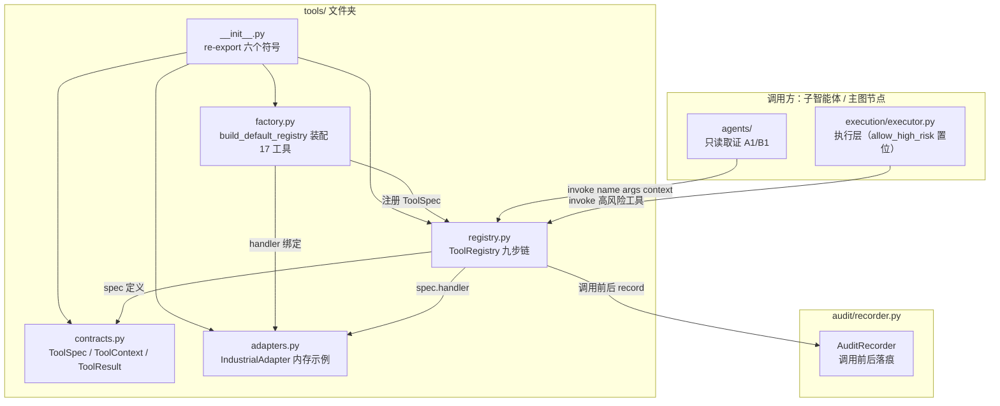

# tools 模块说明

本文件夹是**统一受控工具层**（阶段 4 的实现），是所有智能体访问外部工业系统（WMS/MES/QMS/EAM）的**唯一入口**。它把"工具是什么、能不能调、调了产生什么副作用"全部收敛到一处，并用一条**九步前置检查链**保证：任何工具调用在真正落库/落设备前，都经过存在性、权限、风险、写许可、幂等、审计的层层把关。

这是系统"三道闸纵深防御"中的**工具层闸（九步链）**（另两道是方案层 `PlanValidator`、执行层 `ActionExecutor` 五道闸）——三层独立校验，一层漏了下一层还能兜住。

## 一、设计要点

1. **所有外部访问走唯一入口**：智能体不直接调 adapter，必须经 `ToolRegistry.invoke(name, args, context)`。这样权限、风险、审计、幂等、超时全部集中管控，无法绕过。

2. **九步前置检查链（`ToolRegistry.invoke`）**，任一不通过直接拒绝、**绝不调 handler**：
   | 步骤 | 检查 | 拒绝错误码 |
   |------|------|-----------|
   | 1 | 工具存在性（已注册且启用） | `TOOL_NOT_FOUND` |
   | 2 | 角色权限（`context.roles` 覆盖 `spec.required_roles`） | `PERMISSION_DENIED` |
   | 3 | 高风险许可（`risk=high` 需 `context.allow_high_risk`） | `HIGH_RISK_BLOCKED` |
   | 4 | 写许可（`write`/`control` 需 `context.allow_write`，只读取证/影子模式拦截） | `WRITE_BLOCKED` |
   | 5 | 幂等去重（同 `idempotency_key` 的写/控制直接返回缓存结果） | — |
   | 6 | 调用前审计落痕（`decision=allowed`） | — |
   | 7 | 执行（超时判定 + 只读可重试 + TypeError 视为参数错） | `TOOL_TIMEOUT`/`INVALID_ARGS`/`DOWNSTREAM_UNAVAILABLE`/`NO_DATA` |
   | 8 | 调用后审计落痕（`decision=executed` 或 `denied`） | — |
   | 9 | 成功结果写入幂等缓存（仅写/控制） | — |

3. **工具三维分类（`ToolSpec`）**：`kind`（read 只读 / write 写 / control 控制）+ `risk`（low/medium/high）+ `required_roles`。`high` 风险工具 `auto_executable=False`，必须人工确认后才能把 `context.allow_high_risk` 置 True 执行。

4. **上下文驱动的权限收缩（`ToolContext`）**：`allow_write=False` 用于只读取证智能体（A1/B1）与影子模式，统一拒绝一切写/控制；`allow_high_risk` 只有人工确认通过后才由执行层置 True。默认值是最宽松态，由调用方按场景收紧——**权限只收紧不放宽**。

5. **确定性降级而非崩溃**：下游超时/无数据/异常统一返回 `ToolResult(ok=False, degraded=True)` 带错误码，不抛异常；智能体据此判断"数据缺口"并降级，不会因单个工具失败而中断整条链路。

6. **Adapter 可替换**：`IndustrialAdapter` 是内存示例实现，真实项目替换为 WMS/MES/QMS/EAM 的 HTTP/消息接口即可，`ToolSpec.handler` 指向 adapter 方法，上层无感知。

## 二、文件清单与作用

| 文件 | 作用 | 关键导出 |
|------|------|----------|
| [`__init__.py`](./__init__.py) | 包入口：re-export 六个核心符号，让外部统一导入 | `ToolRegistry` / `ToolSpec` / `ToolContext` / `ToolResult` / `IndustrialAdapter` / `build_default_registry` |
| [`contracts.py`](./contracts.py) | **工具契约**：定义工具元数据 `ToolSpec`（frozen dataclass）、调用上下文 `ToolContext`、统一返回 `ToolResult`，以及 `ToolKind`/`ToolRisk` 枚举 | `ToolSpec` / `ToolContext` / `ToolResult` |
| [`registry.py`](./registry.py) | **工具注册表与执行器**：`ToolRegistry` 是唯一入口，九步前置检查链 + 幂等缓存 + 审计落痕 + 超时重试 | `ToolRegistry.invoke()` / `register()` / `catalog()` |
| [`factory.py`](./factory.py) | **默认工具清单装配**：`build_default_registry` 把 17 个 `ToolSpec`（9 只读 + 5 中风险写 + 3 高风险控制）注册进 registry，handler 绑定到 `IndustrialAdapter` | `build_default_registry()` |
| [`adapters.py`](./adapters.py) | **工业系统适配器**：`IndustrialAdapter` 内存示例实现（设备/报警/工单/库存/批次/质量的查询 + 工单草稿/通知/控制/E-SOP/绑定/调度/实训的写），真实项目替换为外部系统接口 | `IndustrialAdapter` |

## 三、文件之间的协作关系



一次工具调用的九步链（`ToolRegistry.invoke` 内部）：

```
智能体调用 registry.invoke("query_device_status", {"device_id":"D1"}, context=ctx)
   │
   ▼ 步骤 1：存在性 —— self._tools 里查不到 → 返回 ToolResult(TOOL_NOT_FOUND)，走 _deny 落审计
   │
   ▼ 步骤 2：权限 —— ctx.roles 不包含 spec.required_roles → PERMISSION_DENIED
   │
   ▼ 步骤 3：高风险 —— spec.risk=="high" 且 ctx.allow_high_risk==False → HIGH_RISK_BLOCKED
   │
   ▼ 步骤 4：写许可 —— spec.kind in (write,control) 且 ctx.allow_write==False → WRITE_BLOCKED
   │        （只读取证智能体 / 影子模式在此拦截一切写操作）
   │
   ▼ 步骤 5：幂等 —— 有 idempotency_key 的写/控制命中缓存 → 直接返回上次结果（不重复执行）
   │
   ▼ 步骤 6：调用前审计 —— audit.record(decision="allowed", input_snapshot=args)
   │
   ▼ 步骤 7：执行 _execute —— 超时判定 / 只读工具可重试 1 次 / TypeError→INVALID_ARGS / 异常→DOWNSTREAM_UNAVAILABLE / None→NO_DATA
   │
   ▼ 步骤 8：调用后审计 —— audit.record(decision="executed"或"denied", output_snapshot, reason=error_code)
   │
   ▼ 步骤 9：缓存 —— 成功的写/控制结果写入 self._idempotency[key]，下次同 key 直接复用
   │
   ▼ 返回 ToolResult（ok/data 或 ok=False/error_code/degraded）
```

## 四、各文件详解

### 4.1 contracts.py — 工具契约

| 符号 | 类型 | 说明 |
|------|------|------|
| `ToolKind` | `Literal` | 工具类别：`read`（只读查询）/ `write`（有副作用但可回退的写）/ `control`（设备/批次控制，最高风险） |
| `ToolRisk` | `Literal` | 风险等级：`low`（只读，自动可执行）/ `medium`（写草稿/通知，需角色权限）/ `high`（控制类，必须人工确认） |
| `ToolContext` | `BaseModel` | 工具调用上下文：`trace_id`/`incident_id`/`actor`/`roles`/`tenant_id` + 两个许可开关 `allow_high_risk`（默认 False，人工确认后置 True）、`allow_write`（默认 True，只读取证/影子模式置 False） |
| `ToolResult` | `BaseModel` | 工具统一返回：`ok`/`data`/`error_code`/`error_message`/`source`/`fetched_at`/`degraded`（下游异常时为 True，驱动智能体降级） |
| `ToolSpec` | `frozen dataclass` | 工具元数据（不可变）：`name`/`description`/`kind`/`risk`/`required_roles`/`retryable`/`timeout_seconds`/`handler`；属性 `auto_executable = risk != "high"` |

### 4.2 registry.py — 工具注册表（九步链）

`ToolRegistry` 持有 `_tools`（name→spec）、`_audit`（审计器）、`_idempotency`（写/控制结果缓存）。核心方法：
- `register(spec)`：注册工具，重名报错；
- `get(name)` / `names()` / `catalog()`：查询工具清单（`catalog` 供前端/API 展示可用工具及风险）；
- `invoke(name, args, *, context, idempotency_key)`：**九步链主入口**，见上时序；
- `_execute`：执行 handler，含超时、只读重试、异常归一化；
- `_deny`：统一拒绝出口，先落审计再返回 `degraded=True` 的失败结果。

> 所有拒绝路径（`_deny`）和成功路径都写 `AuditRecord`，保证"谁、何时、调了什么、被允许还是拒绝、为什么"全程可追溯。

### 4.3 factory.py — 默认清单装配

`build_default_registry(adapter=None, *, registry=None)` 注册 17 个工具：
- **只读 low（9 个）**：`query_device_status` / `query_recent_alarms` / `query_device_trend` / `query_work_order` / `query_material_stock` / `query_batch` / `query_quality_record` / `reuse_process_template` / `training_score`；
- **写 medium（5 个）**：`load_esop` / `bind_codes` / `create_dispatch_suggestion` / `create_ticket_draft` / `send_notification`（需 production/maintenance/quality/system 角色）；
- **控制 high（3 个）**：`adjust_delivery_route`（production_lead）/ `control_device`（maintenance_lead）/ `freeze_batch`（quality_lead）——`auto_executable=False`，必须人工确认。

`adapter` 与 `registry` 均可注入，便于测试替换（如用 mock adapter 或预填 registry）。

### 4.4 adapters.py — 工业系统适配器

`IndustrialAdapter` 是**内存示例实现**（便于框架联调，无外部依赖），分两类方法：
- **只读查询**：`device_status` / `recent_alarms` / `device_trend` / `work_order` / `stock` / `batch` / `quality` / `reuse_process_template` / `training_score`，从 `__init__` 预置的 fixtures（设备/报警/工单/库存/批次/质量/模板字典）返回；
- **写/控制**：`create_ticket_draft` / `notify` / `control` / `load_esop` / `bind_codes` / `adjust_delivery_route` / `create_dispatch_suggestion`，把入参追加到对应 list 并返回带 id 的记录（模拟落库）。

真实项目：继承或重写这些方法，改为调用 WMS/MES/QMS/EAM 的真实接口，返回结构保持 `dict` 即可，上层 `ToolResult` 包装逻辑不变。

## 五、扩展指南

- **新增工具**：在 `IndustrialAdapter`（或真实 adapter）加方法 → 在 `factory.py` 的 `specs` 列表加 `ToolSpec`（定 `kind`/`risk`/`required_roles`/`handler`）→ 自动进入 registry。高风险写操作务必设 `risk="high"` 并配 `required_roles`，让其走人工确认路径。
- **替换真实数据源**：新建 `RealIndustrialAdapter` 实现同样的方法签名，`build_default_registry(adapter=RealIndustrialAdapter())` 注入；注意所有方法返回 `dict`/`list` 或 `None`（None 会被 registry 转成 `NO_DATA` 降级），不抛业务异常（异常会被归一化为 `DOWNSTREAM_UNAVAILABLE`）。
- **调整九步链**：在 `ToolRegistry.invoke` 里增删检查步骤。新增拒绝分支要走 `_deny`（统一落审计 + 返回 degraded 结果），不要直接 return 裸 ToolResult，否则会漏审计。
- **幂等键策略**：当前写/控制工具用 `idempotency_key` 去重。调用方（执行层）应传入稳定键（如 `plan_id+action_id`），保证重试不重复落库。缓存是内存态，进程重启丢失——若需跨进程幂等，把 `_idempotency` 换成 Redis/DB。
- **工具清单动态化**：当前 `factory.py` 是静态装配。若需按租户/角色动态启用工具，可在 `build_default_registry` 后按 `context.tenant_id` 过滤 `catalog()`，或在 `invoke` 步骤 1 前加租户白名单判断。
- **超时与重试调参**：`ToolSpec.timeout_seconds`（默认 5s）与 `retryable`（仅 read 生效，重试 1 次）按真实接口 SLA 调整；写/控制工具不重试（避免重复副作用），靠幂等键兜底。